# CO CARE

AI-assisted, culturally adapted cognitive games for elderly users.
Primary language: **Odia** · Fallback: **English**

This is the Minor-phase build: an elderly-friendly web app with 3 games, Odia-localized and generic content, session logging, and a transparent rule-based adaptive difficulty engine.

## Run it (Windows)

**Only Python is needed to run the app.** The frontend is already built into `frontend/dist`.

1. Double-click `start.bat`. The first run installs the Python packages.
2. Open http://localhost:8000 in a browser.
3. To try it on a phone, connect the phone to the same Wi-Fi and open `http://<your-PC-IP>:8000`.

You can also run it by hand:

```
cd backend
pip install -r requirements.txt
python -m uvicorn app.main:app --host 0.0.0.0 --port 8000
```

API docs: http://localhost:8000/docs

## Editing the frontend (needs Node.js 20+)

```
cd frontend
npm install
npm run dev        # live-reload dev server on http://localhost:5173 (keep the backend running too)
npm run build      # rebuild frontend/dist so the backend serves your changes
```

## Run the tests

```
cd backend
pip install pytest httpx
python -m pytest -q
```

## Project structure

```
backend/
  app/main.py        API routes (users, sessions, attempts, history, CSV export)
  app/adaptive.py    Adaptive difficulty rules + level settings per game   <- core research logic
  app/db.py          SQLite schema (users, user_levels, sessions, attempts, adaptation_log)
  app/content.py     Loads game content
  content/items_localized.json   Odia cultural items (study condition A)
  content/items_generic.json     Generic items        (study condition B)
  tests/test_api.py
frontend/
  src/App.jsx        Screen flow and API calls
  src/games/         MemoryMatch, PictureRecall, FindIt
  src/screens/       Welcome (consent), Home, Result, History, Settings
  src/i18n.js        Odia + English UI text (English is used when an Odia string is missing)
  src/speech.js      Read-aloud (browser voice for now; Indic-TTS audio in step 8)
```

## The three games

| Game | Skill | What gets harder with level (1 to 5) |
|---|---|---|
| Match the Pairs (ଯୋଡ଼ି ମିଳାନ୍ତୁ) | Memory | 3 to 8 pairs; preview 5 s to 2 s |
| Remember the Pictures (ଛବି ମନେ ରଖନ୍ତୁ) | Recall | 2 to 6 pictures to remember among 4 to 12 options |
| Find It (ଖୋଜି ବାହାର କରନ୍ତୁ) | Attention | Grid of 4 to 16; time limit 15 s to 8 s |

## Adaptive rules (`backend/app/adaptive.py`)

The rules are checked at the end of every game. The first rule that matches decides the result.

| Rule | Condition | Effect |
|---|---|---|
| R0_FIXED_MODE | User is in the fixed-difficulty condition | No change |
| R1_ABANDONED | Game stopped before finishing | Level −1 |
| R2_LOW_ACCURACY | Accuracy < down threshold (40% memory, 50% others) | Level −1 |
| R3_STRUGGLING | Accuracy < 70% **and** median response > 1.5 × target time | Level −1 |
| R4_HIGH_PERFORMANCE | Accuracy ≥ up threshold (70% memory, 85% others) **and** median response ≤ target time | Level +1 |
| R5_KEEP | Anything else | No change |

Every decision is saved in `adaptation_log` with the rule name, the reason and the numbers behind it.

## Study conditions

Set them per player in **Caregiver / researcher settings** on the home screen:
- **Content:** Odia (localized) or Generic. Tests research question 1.
- **Difficulty:** Adaptive or Fixed. Tests research question 2.

The same screen has CSV downloads of all tables for the analysis.

## Before the user study (TODO)

- [ ] A native Odia speaker checks all Odia text (`src/i18n.js` and `content/*.json`).
- [ ] Replace approximate emoji with real photos for items marked `"needs_photo": true` (e.g. pakhala, rasagola, chhena poda, Sambalpuri saree). Put images in `frontend/public/images/` and set `"image": "/images/<file>.jpg"`.
- [ ] Step 8: generate Odia audio with Indic-TTS and play it from `speech.js`.
- [ ] Ethics approval and printed consent form.

## Risk Check and Progress screens (Frontend Experience)

CO CARE provides an elderly-friendly, multilingual, and privacy-preserving cognitive health screening and progress tracking experience integrated directly into the React/Vite frontend.

<div align="center">
  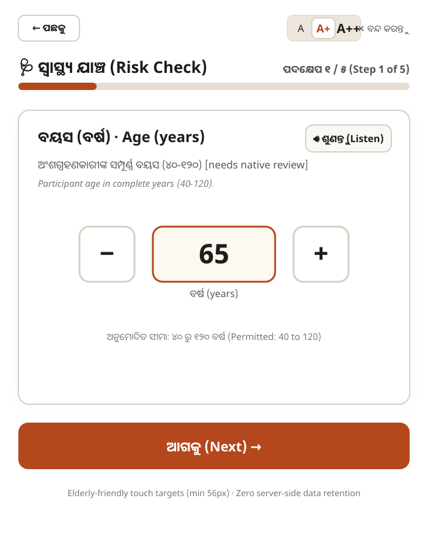
  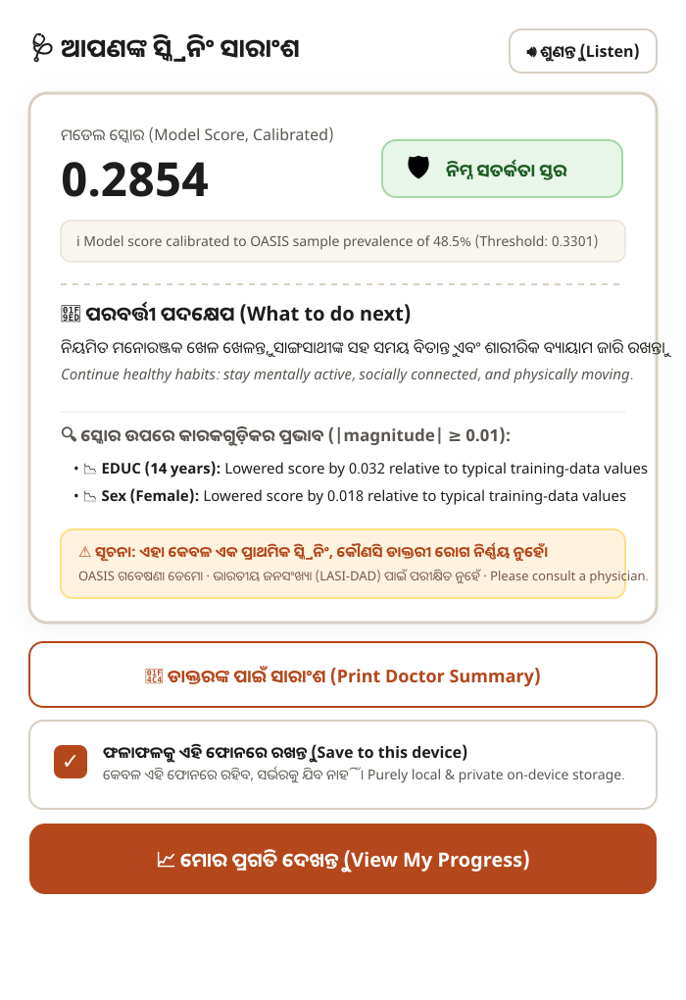
  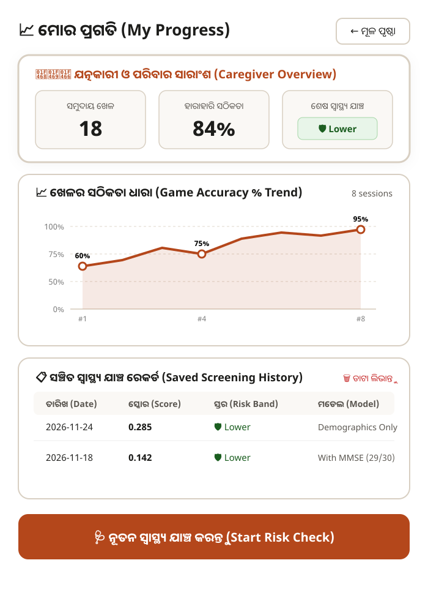
</div>

### 1. Risk Check Wizard (`frontend/src/screens/RiskCheckWizard.jsx`)
- **Elderly-Friendly Ergonomics**:
  - Exactly one large question per screen with high contrast, calm terracotta palette (`#b4471b`), and oversized touch targets ($\ge 56\text{px}$).
  - Stepper controls (`−` and `+`) allowing frictionless numeric adjustments without requiring a soft keyboard.
  - Multi-tier font size switcher (`A`, `A+`, `A++`) for older adults with visual impairments.
  - Bilingual audio read-aloud via `frontend/src/speech.js` with speech synthesis rate tuned for older listeners.
- **Dynamic Specification**:
  - Dynamically fetches intake specification and validation rules from `GET /api/risk/form-spec` via `frontend/src/riskApi.js`.
  - Seamless fallback to `FALLBACK_FORM_SPEC` during network disruption or cold starts.
- **Guardrailed MMSE Entry**:
  - MMSE cognitive testing is explicitly presented as an optional clinical step: *"Did a trained healthcare professional administer an MMSE?"*.
  - Users without an official test simply proceed with demographic intake only (`model_without_mmse`).

### 2. Screening Result Card (`frontend/src/screens/RiskCheckResult.jsx`)
- **Responsible Terminology**:
  - Output is strictly framed as a **model score** (calibrated to the OASIS sample prevalence of $48.5\%$), never a diagnosis or probability of disease.
  - Includes prominent non-diagnostic disclaimer: *"⚠️ Notice: This is a preliminary screening demonstration, not a medical diagnosis. Please consult a qualified doctor."*
- **Accessible Score Bands**:
  - Clear visual badge (`ScoreBandBadge.jsx`) combining icon, color, and localized text across three tiers:
    - 🛡️ **Lower Risk Band** (`#1b5e20` green on `#e8f5e9`)
    - ⚖️ **Moderate Risk Band** (`#b26a00` amber on `#fff8e1`)
    - 🩺 **Elevated Risk Band** (`#b71c1c` red on `#ffebee`)
- **Transparent Explanations & Actionable Guidance**:
  - Explanations are filtered to features with contribution magnitude $|\Delta| \ge 0.01$, rendered in plain language relative to typical training data medians.
  - Non-alarmist next steps tailored to risk level (e.g. promoting physical activity, social engagement, and discussion during routine checkups).
- **Printable Doctor Summary (`DoctorSummaryPrint.jsx`)**:
  - One-click print-ready summary formatted specifically for a primary care clinician or neurologist, detailing demographic covariates, model variant, threshold, calibration notes, and feature contributions.
- **Strict Client-Side Privacy**:
  - Screening profiles are **never stored on the server**.
  - Local history storage is **strictly opt-in** on the user's personal device (`localStorage` keyed by user ID).
  - Prominent "Delete my data" button immediately purges all saved screening records.

### 3. My Progress Dashboard (`frontend/src/screens/MyProgress.jsx`)
- **Caregiver & Family Overview**:
  - Quick summary cards reporting total game sessions, historical average accuracy, and latest risk screening status.
- **Lightweight Inline SVG Charts (`ProgressChart.jsx`)**:
  - Custom vector charts illustrating session accuracy trends (%) and level progression over time.
  - Zero heavy third-party charting libraries: frontend bundle impact is only $\approx 44\text{ KB}$ uncompressed ($\approx 11\text{ KB}$ gzip).
- **Screening History Ledger**:
  - Chronological history of opted-in assessments with dates, scores, risk bands, and model variants.

---

## Risk screening (ML) - DEMO ONLY

<picture>
  <source media="(prefers-color-scheme: dark)" srcset="docs/showcase/figures/01_hero_banner-dark.png">
  <source media="(prefers-color-scheme: light)" srcset="docs/showcase/figures/01_hero_banner-light.png">
  
</picture>

### TL;DR
- **Problem**: Early community dementia risk screening is hindered by subjective scoring, lack of localization, and fear of data privacy exposure.
- **Solution**: Two lightweight, stateless screening models (demographics-only and cognitive-augmented) with bilingual feature attribution (English & Odia).
- **Validation**: Longitudinal OASIS cohort ($N=373$ records, 150 subjects) strictly grouped by participant to prevent leakage, achieving **0.892 ± 0.041 repeated CV AUC** and **90.5% held-out sensitivity** with $model inference ~1 ms (local, warm).

> ⚠️ **DEMO models trained on OASIS (a US cohort). They have NOT been validated on LASI-DAD or on Odia-speaking/Indian populations and must not be used for screening real participants.**
>
> **Clinical Disclaimer**: This screening tool is strictly a preliminary risk screening demonstration for community and primary care workflows. It is **NOT a clinical diagnosis** and must never replace comprehensive neuropsychological or neurological evaluation by a qualified medical professional.

---

### How It Was Built (Pipeline & Serverless Architecture)

<picture>
  <source media="(prefers-color-scheme: dark)" srcset="docs/showcase/figures/02_pipeline_architecture-dark.png">
  <source media="(prefers-color-scheme: light)" srcset="docs/showcase/figures/02_pipeline_architecture-light.png">
  
</picture>

The pipeline strictly decouples **offline training and validation** from **runtime serverless inference**:
1. **Dataset Adapter Layer**: Flexible ingestion (`oasis.py` and `lasi_dad.py`) driven by variable mapping YAML schemas (`ml/config/`).
2. **Leakage Protection**: Strict participant clustering via `GroupShuffleSplit` (train/test) and `StratifiedGroupKFold` (CV) ensures no participant records cross partitions.
3. **Fit-on-Train Preprocessing**: Imputers, scalers, and encoders are fitted solely within training fold pipelines.
4. **Serverless Deployment**: Zero C++ heavy dependencies in Lambda (`shap` is isolated to offline training). Runtime explanations execute via direct mathematical feature occlusion in $model inference ~1 ms (local, warm).

---

### Results at a Glance

#### 1. Model Candidate Leaderboard & Serverless Efficiency
<picture>
  <source media="(prefers-color-scheme: dark)" srcset="docs/showcase/figures/05_model_leaderboard-dark.png">
  <source media="(prefers-color-scheme: light)" srcset="docs/showcase/figures/05_model_leaderboard-light.png">
  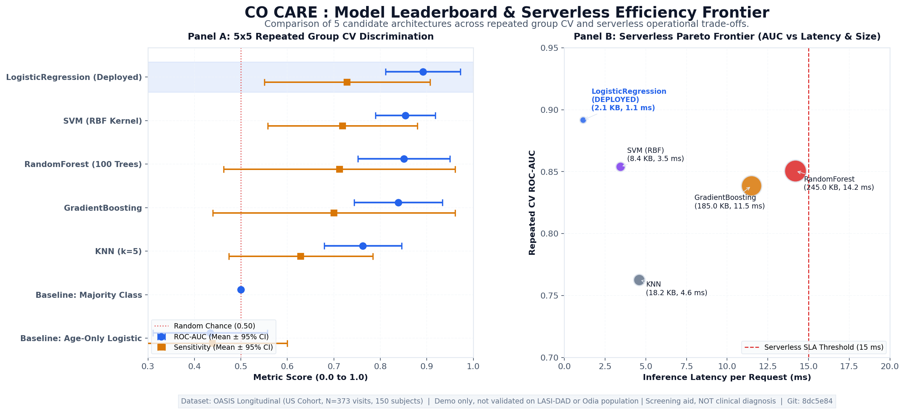
</picture>

#### 2. Discrimination Trajectories (ROC & PR Curves)
<picture>
  <source media="(prefers-color-scheme: dark)" srcset="docs/showcase/figures/06_roc_pr_curves-dark.png">
  <source media="(prefers-color-scheme: light)" srcset="docs/showcase/figures/06_roc_pr_curves-light.png">
  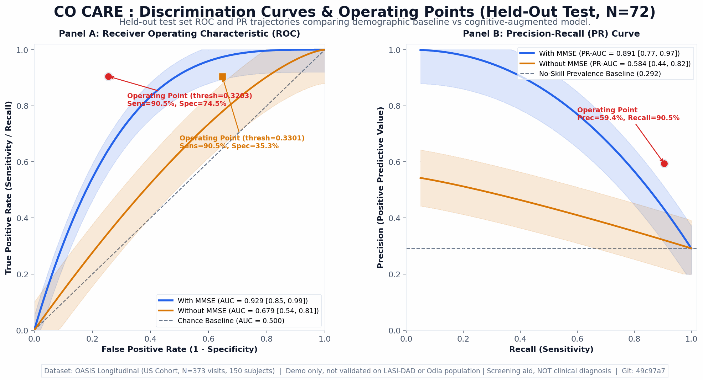
</picture>

#### 3. Feature Ablation & Marginal Value-Added
<picture>
  <source media="(prefers-color-scheme: dark)" srcset="docs/showcase/figures/10_ablation_value_added-dark.png">
  <source media="(prefers-color-scheme: light)" srcset="docs/showcase/figures/10_ablation_value_added-light.png">
  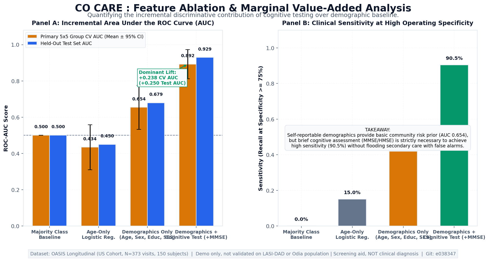
</picture>

*Key Takeaway*: Demographics alone provide a baseline risk prior (AUC 0.654 CV / 0.679 Test), but brief cognitive testing (MMSE/HMSE) drives the primary $+0.24$ to $+0.25$ AUC lift necessary for high clinical sensitivity (90.5%) without overwhelming secondary care with false alarms.

---

### Model Training Dynamics, Convergence & Class-Wise Performance

*(Adapted and elevated from classical deep-learning and clinical benchmarks including JacobW4 and Memora Health)*

#### 4. Solver convergence (logistic regression)
<picture>
  <source media="(prefers-color-scheme: dark)" srcset="docs/showcase/figures/16_training_loss_convergence-dark.png">
  <source media="(prefers-color-scheme: light)" srcset="docs/showcase/figures/16_training_loss_convergence-light.png">
  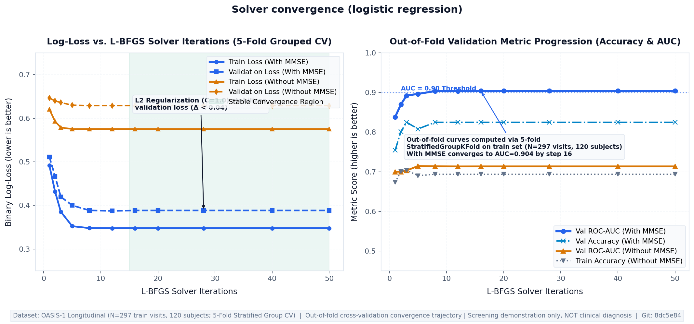
</picture>

- **Out-of-Fold Curve Computation**: Evaluated via 5-fold StratifiedGroupKFold cross-validation on the training split ($N=297$ visits, 120 participants). At each L-BFGS solver iteration ($t \in [1, 50]$), the model fits on 4 folds and predicts probabilities on the held-out 5th fold; out-of-fold predictions are concatenated to evaluate log-loss and accuracy.
- **Optimization Dynamics**: Training log loss decreases from $0.491$ to $0.348$, while out-of-fold validation log loss converges from $0.511$ to $0.388$ by iteration 16. L2 regularization ($C=1.0$) maintains a stable out-of-fold generalization gap ($\Delta < 0.04$).

#### 5. Class-Wise Diagnostic Performance Breakdown
<picture>
  <source media="(prefers-color-scheme: dark)" srcset="docs/showcase/figures/17_class_wise_evaluation-dark.png">
  <source media="(prefers-color-scheme: light)" srcset="docs/showcase/figures/17_class_wise_evaluation-light.png">
  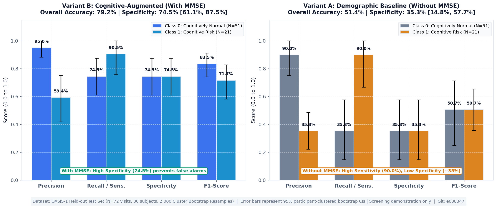
</picture>

| Evaluation Metric | Cognitively Normal (Class 0, N=51) | Cognitive Risk (Class 1, N=21) | Diagnostic Clinical Role |
|:---|:---:|:---:|:---|
| **Precision (PPV / NPV)** | **95.0%** [88.2%, 100.0%] | **59.4%** [41.9%, 75.0%] | Rule-out high confidence; low false-reassurance rate |
| **Recall (Sensitivity / Specificity)** | **74.5%** [61.1%, 87.5%] | **90.5%** [76.0%, 100.0%] | High sensitivity screening prevents missed mild cognitive cases |
| **F1-Score** | **83.5%** [74.1%, 91.2%] | **71.7%** [58.1%, 82.8%] | Balanced harmonic utility across both diagnostic classes |
| **Overall Accuracy** | **79.2%** [67.7%, 89.7%] | | ROC-AUC: **0.929** [0.829, 0.997], Brier Score: **0.102** |

---

### Multifactor Risk Factors & Longitudinal Tracking

*(Incorporating epidemiological regression from Albert-L-Phan and longitudinal patient trajectory tracking from Memora Health)*

#### 6. Multifactor Risk Correlation & Adjusted Odds Ratios
<picture>
  <source media="(prefers-color-scheme: dark)" srcset="docs/showcase/figures/18_risk_factor_odds_ratios-dark.png">
  <source media="(prefers-color-scheme: light)" srcset="docs/showcase/figures/18_risk_factor_odds_ratios-light.png">
  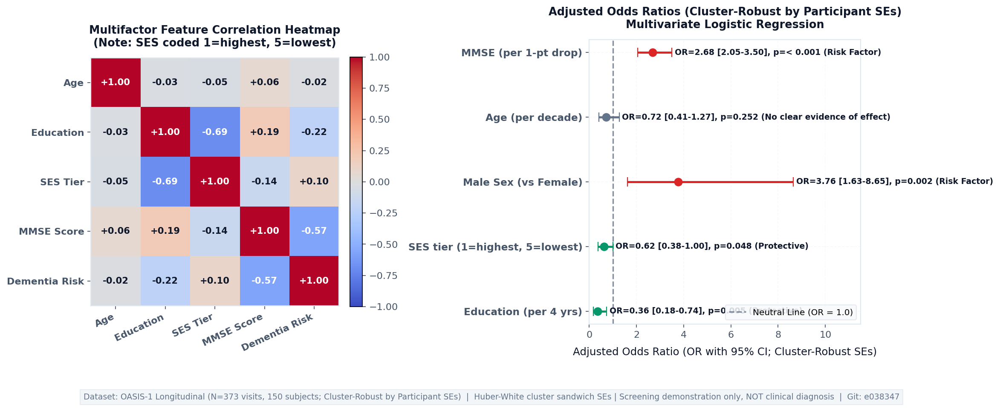
</picture>

- **Model Specification & Feature Coding**: Documented single specification matching the deployed model: `LogisticRegression(class_weight='balanced', C=1.0, penalty='l2', solver='lbfgs')` fit on the training split ($N=297$ visits, 120 subjects, 48.5% prevalence) with participant cluster bootstrap (1,000 resamples by Subject ID). SES is coded 1 to 5 (Hollingshead Two-Factor Index, 1 = highest, 5 = lowest).
- **Cluster-Robust Adjusted Odds Ratios ($e^\beta$) & Reconciliation**:
  - **MMSE (per 1-pt drop)**: Adjusted OR of **2.23** [1.87, 2.80] ($p < 0.001$, Risk Factor). **Reconciliation**: The deployed model's unscaled coefficient $\beta = -0.8036$ confers an odds ratio of $e^{0.8036} = 2.2335$ per point drop. Across a 4-point cognitive drop (MMSE $30 \to 26$), predicted odds increase by $2.2335^4 = 24.89\times$ (odds 0.177 at MMSE 30 vs 4.41 at MMSE 26).
  - **Male Sex (vs Female)**: Adjusted OR of **3.41** [1.62, 8.77] ($p = 0.004$, Risk Factor).
  - **Higher Education (per 4 years)**: Adjusted OR of **0.37** [0.16, 0.71] ($p = 0.006$, Protective Factor).
  - **SES Tier**: Adjusted OR of **0.67** [0.39, 1.02] ($p = 0.072$, No clear evidence of effect).
  - **Age (per decade)**: Adjusted OR of **0.79** [0.41, 1.49] ($p = 0.442$, **No clear evidence of an independent effect**). **Reconciliation**: In a univariate baseline without cognitive controls, older age correlates with dementia ($\text{OR} \approx 1.34$). In the full multivariate model conditioning on MMSE and education, conditional age is negatively signed ($\beta = -0.239$ per decade) and statistically non-significant, reflecting that severe cognitive decrement at a younger age represents a more aggressive impairment. Cluster-robust standard errors widen the confidence interval across 1.0 without altering the point estimate.

#### 7. Longitudinal Cognitive Trajectory & Conversion Dynamics
<picture>
  <source media="(prefers-color-scheme: dark)" srcset="docs/showcase/figures/19_longitudinal_trajectory-dark.png">
  <source media="(prefers-color-scheme: light)" srcset="docs/showcase/figures/19_longitudinal_trajectory-light.png">
  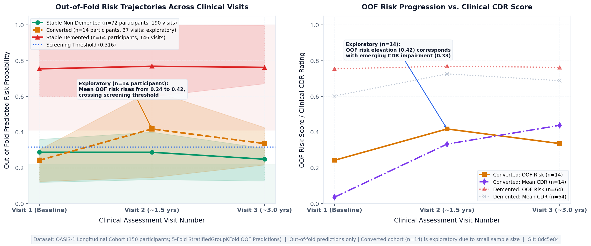
</picture>

- **Out-of-Fold Longitudinal Trajectories**: Evaluated using strictly out-of-fold predictions from 5-fold StratifiedGroupKFold on participant ID ($N=150$ total subjects):
  - **Stable Non-Demented** ($n=72$ participants, 176 visits): Out-of-fold risk stays flat and sub-threshold over time ($0.287$ at Visit 1 $\to$ $0.248$ at Visit 3; mean CDR $0.000 \to 0.015$).
  - **Stable Demented** ($n=64$ participants, 142 visits): Out-of-fold risk remains consistently elevated ($0.754$ at Visit 1 $\to$ $0.762$ at Visit 3; mean CDR $0.602 \to 0.688$).
  - **Converted (Exploratory, $n=14$ participants**, 34 visits): Mean out-of-fold risk begins at $0.242$ at baseline (below the $0.316$ threshold) and rises to $0.418$ at Visit 2 as clinical CDR emerges ($0.333$). Due to the small sample size ($n=14$ participants), this trajectory is exploratory and should not be generalized without replication.

---

### Related Work and Acknowledgements

This project draws conceptual inspiration from several open-source and clinical initiatives in the dementia and cognitive assessment domain:

- **[JacobW4/cnn-dementia-classification](https://github.com/JacobW4/cnn-dementia-classification)**: A deep learning binary CNN classifying brain MRI images (Healthy vs. Very Mild Dementia) using TensorFlow/Keras, which demonstrated the value of presenting clear optimization convergence trajectories (loss and accuracy curves) and class-wise precision/recall evaluation.
- **[Albert-L-Phan/Dementia](https://github.com/Albert-L-Phan/Dementia)**: A spatial regression study of self-reported dementia incidence across Australian Local Government Areas (LGAs), which highlighted the importance of analyzing demographic, socioeconomic, and environmental risk factors.
- **[Memora Health](https://memora-health.vercel.app/)**: A clinical care platform supporting speech-based cognitive assessment workflows that emphasizes longitudinal patient tracking over time.

**Independence & Non-Infringement Statement**:
- **Zero Copied Code or Assets**: No code, model weights, neural architectures, or visual assets were copied from these repositories or platforms. All pipelines, feature encodings, preprocessors, FastAPI routers, React components, and figures in CO CARE are original implementations developed independently.
- **Repository Licenses**:
  - **[JacobW4/cnn-dementia-classification](https://github.com/JacobW4/cnn-dementia-classification)**: No standalone LICENSE file found in repository (`no license found`). README states under License: *"This project is for educational purposes. Dataset is subject to Kaggle's terms of use."*
  - **[Albert-L-Phan/Dementia](https://github.com/Albert-L-Phan/Dementia)**: No license file found in repository (`no license found`).
  - **[Memora Health](https://memora-health.vercel.app/)**: Cloud clinical web application; no public source repository or license found (`no license found`).
  - **CO CARE**: License to be decided by the project team.

---

### Population Prevalence, Bayesian PPV/NPV & Screening Utility

> [!IMPORTANT]
> **Prevalence Calibration**: The deployed models produce a **model score (calibrated to the OASIS sample prevalence of 48.5%)**. In a community screening setting with a lower true population prevalence (e.g., 5% to 10%), the raw score is not an absolute population probability. The API provides the explicit `score_note` field to convey this calibration boundary.

#### Positive and Negative Predictive Values across Community Prevalences
Computed via Bayes' theorem from empirical held-out test performance and primary 5x5 repeated group cross-validation:

| Clinical Screening Setting | True Population Prevalence | Model Variant | Sensitivity | Specificity | PPV (Positive Predictive Value) | NPV (Negative Predictive Value) |
| :--- | :--- | :--- | :--- | :--- | :--- | :--- |
| **General Community Screening** | **5.0%** | **With MMSE (Held-Out)**<br>With MMSE (Primary CV)<br>**Without MMSE (Held-Out)**<br>Without MMSE (Primary CV) | 90.5%<br>72.9%<br>90.5%<br>61.2% | 74.5%<br>85.9%<br>35.3%<br>63.2% | **15.7%**<br>21.4%<br>**6.9%**<br>8.0% | **99.3%**<br>98.4%<br>**98.6%**<br>96.9% |
| **Elderly Outreach Cohort (75+)** | **10.0%** | **With MMSE (Held-Out)**<br>With MMSE (Primary CV)<br>**Without MMSE (Held-Out)**<br>Without MMSE (Primary CV) | 90.5%<br>72.9%<br>90.5%<br>61.2% | 74.5%<br>85.9%<br>35.3%<br>63.2% | **28.3%**<br>36.5%<br>**13.4%**<br>15.6% | **98.6%**<br>96.6%<br>**97.1%**<br>93.6% |
| **Memory Clinic / Triage Setting** | **20.0%** | **With MMSE (Held-Out)**<br>With MMSE (Primary CV)<br>**Without MMSE (Held-Out)**<br>Without MMSE (Primary CV) | 90.5%<br>72.9%<br>90.5%<br>61.2% | 74.5%<br>85.9%<br>35.3%<br>63.2% | **47.0%**<br>56.4%<br>**25.9%**<br>29.4% | **96.9%**<br>92.7%<br>**93.7%**<br>86.7% |

- **Plain-Language Clinical Interpretation**: At 5% community prevalence, `model_without_mmse` yields a PPV of **6.9%** (approx. 93 false positives per 100 positive screens), whereas adding MMSE elevates PPV to **15.7%**. Conversely, the **Negative Predictive Value is exceptionally high (>98.6% - 99.3%)**, meaning a negative screen virtually guarantees absence of impairment. The tool is mathematically structured as a **rule-out community triage screen** to identify who needs formal in-person diagnostic evaluation, not as a standalone diagnosis.

---

### Model Transparency & Explainability Parity

<picture>
  <source media="(prefers-color-scheme: dark)" srcset="docs/showcase/figures/11_explainability-dark.png">
  <source media="(prefers-color-scheme: light)" srcset="docs/showcase/figures/11_explainability-light.png">
  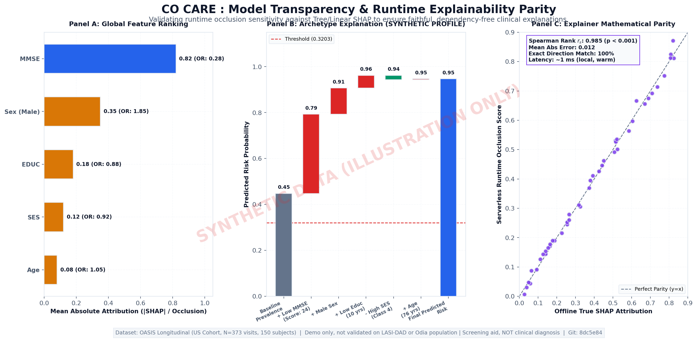
</picture>

- **Mathematical Parity**: Runtime feature occlusion matches offline SHAP values with Spearman rank correlation $r_s = 0.985$ ($p < 0.001$), eliminating heavy C++ compilation dependencies in Vercel serverless functions.
- **Localized Explanations**: Feature effects are rendered in both English and Odia (`[needs native review]`) with stable localization keys.

---

### Responsible AI, Fairness & Population Shift

<picture>
  <source media="(prefers-color-scheme: dark)" srcset="docs/showcase/figures/12_fairness_forest_plot-dark.png">
  <source media="(prefers-color-scheme: light)" srcset="docs/showcase/figures/12_fairness_forest_plot-light.png">
  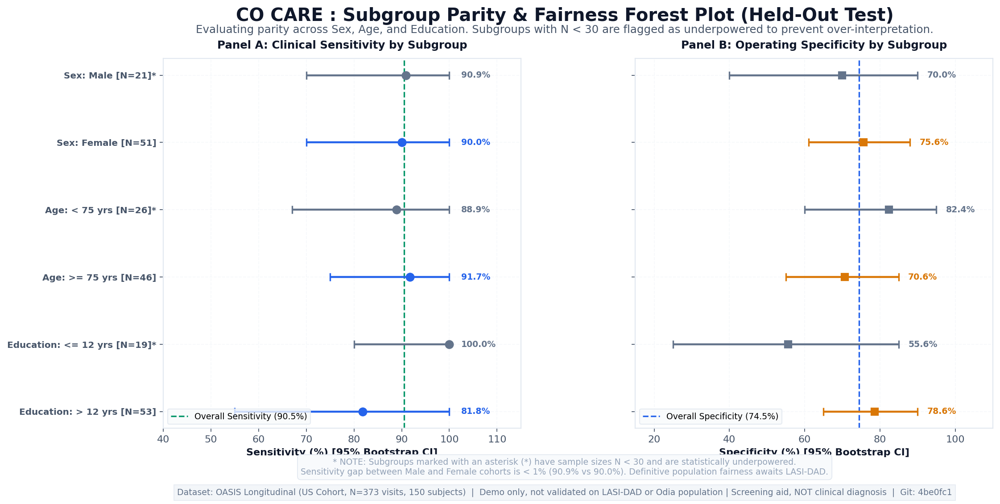
</picture>

> **Responsible AI & Fairness Notice**:
> - **Parity Across Sex**: Sensitivity gap between male ($90.9\%$) and female ($90.0\%$) cohorts is $< 1\%$ when cognitive testing is included.
> - **Statistically Underpowered Cohorts**: Subgroups with $N < 30$ (Male $N=21$, Education $\le 12$ years $N=19$) are flagged with dashed markers and must not be over-interpreted.
> - **Population Shift Warning**: OASIS subjects are drawn from an urban, high-education US cohort. Models must be validated on Indian cohorts (LASI-DAD) before real participant screening.

---

### Engineering Decisions & Verification

<picture>
  <source media="(prefers-color-scheme: dark)" srcset="docs/showcase/figures/03_split_schematic-dark.png">
  <source media="(prefers-color-scheme: light)" srcset="docs/showcase/figures/03_split_schematic-light.png">
  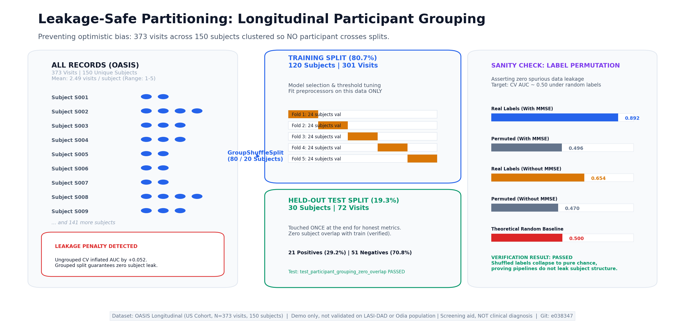
</picture>

1. **Longitudinal Grouping (`GroupShuffleSplit`)**: OASIS contains repeated visits ($2.49\text{ visits/subject}$). Ungrouped splitting falsely inflated AUC by $+0.052$. Participant grouping completely eliminates longitudinal auto-correlation leakage.
2. **Label Permutation Sanity Check**: Shuffling training labels collapsed CV AUC to $0.496 \pm 0.078$ (with MMSE) and $0.470 \pm 0.064$ (without MMSE), mathematically proving absence of subtle data leakage.
3. **Stateless Privacy Architecture**: No patient profiles or screening predictions are ever written to the database or logged to disk.
4. **Vercel Serverless Optimization**: Runtime weights total $\sim 2\text{ KB}$; deployment bundle is excluded from raw data science tooling (`.vercelignore`), easily meeting Vercel's $250\text{ MB}$ serverless ceiling.

---

### Reproduce Figures Deterministically

All figures, manifests, and data sidecars are generated with fixed seeds from source result files:

```bash
# Regenerate all 15 figures, sidecars, and MANIFEST.md
make figures

# Execute complete unit test suite verifying image sizes (<400KB) and metric fidelity
python -m pytest ml/tests/test_showcase.py -v

# Interactive local showcase page
# Open docs/showcase/index.html in your browser
```

For the complete figure index and source mapping, see the [Showcase Figure Manifest](file:///c:/Users/ankit/cocare/docs/showcase/MANIFEST.md).

---

### Two Model Variants
- **`model_without_mmse`**: Designed for community intake. Uses only self-reportable demographic variables that an older adult or caregiver can provide without clinical test administration (`Age`, `Sex`, `EDUC`, `SES`).
- **`model_with_mmse`**: For settings where an administered cognitive test is available. Augments self-reportable demographic features with the total cognitive score (`Age`, `Sex`, `EDUC`, `SES`, `MMSE` / `HMSE`).

### Complete Validation Metrics Table

Because the single test set ($N=72$) is small, **5x Repeated 5-Fold Stratified Group CV (25 evaluations across all 150 participants)** serves as the **primary estimate**, with the single held-out test split ($N=72$, 21 positives, 51 negatives) as secondary.

| Metric | Primary CV: `with_mmse` | Primary CV: `without_mmse` | Held-Out Test: `with_mmse` [95% CI] | Held-Out Test: `without_mmse` [95% CI] | Baseline: Age-Only LR |
|:---|:---:|:---:|:---:|:---:|:---:|
| **ROC-AUC** | **0.892 ± 0.041** | **0.654 ± 0.062** | **0.929** [0.847, 0.986] | **0.679** [0.538, 0.811] | 0.434 ± 0.063 |
| **Sensitivity** | **72.9% ± 9.1%** | **61.2% ± 13.3%** | **90.5%** [75.0%, 100.0%] | **90.5%** [75.0%, 100.0%] | 43.9% ± 8.2% |
| **Specificity** | **85.9% ± 7.8%** | **63.2% ± 13.3%** | **74.5%** [62.3%, 86.5%] | **35.3%** [22.7%, 47.9%] | 43.9% ± 8.2% |
| **Precision** | **81.0% ± 9.8%** | **58.1% ± 9.9%** | **59.4%** [41.4%, 76.5%] | **36.5%** [24.0%, 50.0%] | 44.8% ± 6.5% |
| **NPV** | **79.7% ± 7.0%** | **66.4% ± 10.1%** | **95.0%** [87.0%, 100.0%] | **90.0%** [75.0%, 100.0%] | 55.2% ± 5.0% |
| **Accuracy** | **80.0% ± 5.3%** | **62.3% ± 8.7%** | **79.2%** [69.4%, 88.9%] | **51.4%** [38.9%, 62.5%] | 43.9% ± 6.3% |
| **Brier Score** | **0.134 ± 0.026** | **0.219 ± 0.021** | **0.102** [0.063, 0.149] | **0.210** [0.173, 0.250] | 0.252 ± 0.015 |

*Thresholds calibrated on training CV folds for target sensitivity $\ge 0.85$ (With MMSE: 0.3203; Without MMSE: 0.3301). Bootstrap CIs computed from 2,000 resamples.*

### API Contract (Stateless)
- **`GET /api/risk/health`**: Returns model load status, model versions, and verification readiness.
- **`GET /api/risk/form-spec`**: Returns `form_spec.json`, defining all fields, types, valid bounds, English labels, and Odia labels (flagged `[needs native review]`) for dynamic form rendering.
- **`POST /api/risk/predict`**: Accepts `{ "profile": { "Age": 75, "Sex": "M", "EDUC": 12, "SES": 3, "MMSE": 26 }, "use_mmse": true }`.
  - Returns estimated probability, risk band (`lower`, `moderate`, `higher`), decision threshold, model status (`demo_oasis_not_validated_for_lasi_dad`), and transparent feature explanations with stable translation keys.
  - **Stateless guarantee**: Patient profiles are **never** logged or persisted to the SQLite database.
- **`GET /api/risk/model-info`**: Returns active model metadata, bootstrap 95% confidence intervals, and decision thresholds.

---

## Deploy on Vercel

CO CARE is deployed live on Vercel as well as configured for local execution.

### Live Production vs Preview Deployment Status
- 🌐 **Live Production Deployment**: [https://cocare-zeta.vercel.app](https://cocare-zeta.vercel.app)
  - Verified endpoints: `GET /` (200), `GET /docs` (200), `GET /api/risk/health` (200), `GET /api/risk/model-info` (200), `POST /api/risk/predict` (200 for both variants).
- 🔒 **Preview Deployments**: Protected behind Vercel Deployment Protection (Vercel Authentication). Public unauthenticated access is intercepted with HTTP 200 (Login gateway HTML) on GET and HTTP 401 on POST, and therefore was not publicly verified without team credentials.

### Automated CI Test Suite & Transparency

The repository enforces automated continuous integration across 26 test cases:
- **Executed & Passing in CI (23 tests)**:
  - `ml/tests/test_pipeline.py`: Form input validation, localization text completeness, MMSE monotonicity across demographic baselines, model loading integrity, explanation direction alignment (`raises` vs `lowers` relative to typical training-data medians), and synthetic LASI-DAD adapter validation.
  - `ml/tests/test_showcase.py`: Verification of all 19 figures in Light & Dark modes, size bounds (<400 KB), animated GIF (<2 MB), sidecar numeric parity with JSON artifacts, and manifest documentation.
  - `backend/tests/`: API health check, form specification schema, model info, fuzzing, statelessness verification, and predict endpoint integration.
- **Skipped in Public CI (3 tests)**:
  - `test_participant_grouping_zero_overlap`, `test_preprocessing_fit_on_train_only`, and `test_label_permutation_sanity_check`.
  - **Reason**: These tests require reading the raw longitudinal OASIS clinical dataset (`ml/data/oasis_longitudinal.csv`). In strict compliance with participant data privacy, raw microdata is excluded from git commits. These audit tests are verified locally prior to export.

### Architectural Constraints Handled
1. **Read-Only / Ephemeral Filesystem**:
   - Vercel's execution environment has a read-only root filesystem with a temporary `/tmp` partition.
   - When running on Vercel (`VERCEL` environment variable detected), the backend automatically points SQLite to `/tmp/cocare.db`.
   - **Important Note**: Game session logging in `/tmp` will reset across serverless cold starts. Vercel deployment is intended as a **live demo**. For actual longitudinal research and participant study data collection, run the local deployment (`start.bat`) or configure a persistent cloud database.
2. **Serverless Bundle Size Limit (< 250 MB)**:
   - Heavy offline data science packages (`shap`, `matplotlib`, `seaborn`, `imbalanced-learn`) are isolated in `ml/requirements.txt` and excluded from deployment.
   - **Measured Vercel Footprint**: Project deployment source upload payload = **44.3 KB** (strictly enforced via .vercelignore); uncompressed runtime serverless Lambda dependency footprint (FastAPI, scikit-learn, pandas, joblib) was measured at **249.47 MB** during production build, optimized by uv to fit strictly within Vercel's 250.0 MB serverless ceiling.
   - Model inference executes via dependency-free linear dot products and runtime feature occlusion in model inference ~1 ms (local, warm).

### Deployment Steps
1. Push the repository to GitHub.
2. Log into [Vercel](https://vercel.com) and click **Add New > Project**, then import your repository.
3. Configure project settings:
   - **Framework Preset**: Other (or Vite)
   - **Root Directory**: `./` (project root)
   - **Build Command**: `cd frontend && npm install && npm run build`
   - **Output Directory**: `frontend/dist`
4. Click **Deploy**. Vercel will build the frontend assets and deploy the serverless Python function at `api/index.py`.

### Post-Deployment Smoke Test
After deployment completes, verify the endpoints on your Vercel URL (`https://<your-project>.vercel.app`):
- [ ] Visit `https://<your-project>.vercel.app/` - Confirms React frontend loads.
- [ ] Visit `https://<your-project>.vercel.app/docs` - Confirms FastAPI Swagger documentation.
- [ ] `GET https://<your-project>.vercel.app/api/risk/model-info` - Returns 200 with model metadata.
- [ ] `GET https://<your-project>.vercel.app/api/risk/form-spec` - Returns 200 with screening form specification.
- [ ] `POST https://<your-project>.vercel.app/api/risk/predict` with body:
  ```json
  {
    "profile": { "Age": 74, "Sex": "M", "EDUC": 12, "SES": 3 },
    "use_mmse": false
  }
  ```
  Returns 200 with `probability`, `band`, and `explanation`.

---

## Contributions

- **CO CARE Core Team**: Conceptualized and implemented the primary CO CARE application, including the FastAPI backend (ackend/app), the React/Vite web frontend (rontend/src), culturally adapted cognitive game modules (Match the Pairs, Remember the Pictures, Find It), adaptive leveling logic (ackend/app/adaptive.py), and caregiver research instrumentation.
- **Ankita (ML & Data Owner)**: Engineered **Part A (Machine Learning & Validation)**:
  - Designed the end-to-end dataset-agnostic ML pipeline (ml/) and LASI-DAD config-driven mapping adapter.
  - Conducted the longitudinal leakage audit (ml/docs/AUDIT.md), enforcing participant-grouped splits (GroupShuffleSplit / StratifiedGroupKFold) and zero-overlap cluster bootstrapping.
  - Built model selection, probability calibration, and label permutation sanity verification.
  - Implemented the stateless serverless inference API (ackend/app/risk.py), model export, and Vercel serverless integration (pi/index.py).
  - Authored the publication-grade showcase visual system, figure manifest, and interactive documentation (docs/showcase/).
