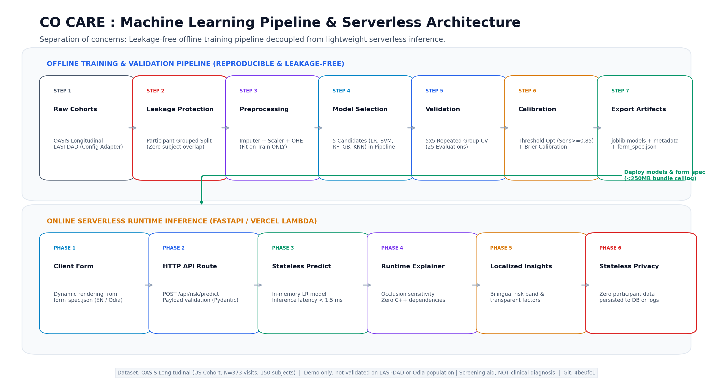

# CO CARE

AI-assisted, culturally adapted cognitive games for elderly users.
Primary language: **Odia** · Fallback: **English**

This is the Minor-phase build: an elderly-friendly web app with 3 games, Odia-localized and generic content, session logging, and a transparent rule-based adaptive difficulty engine.

## Run it (Windows)

**Only Python is needed to run the app.** The frontend is already built into `frontend/dist`.

1. Double-click `start.bat`. The first run installs the Python packages.
2. Open http://localhost:8000 in a browser.
3. To try it on a phone, connect the phone to the same Wi-Fi and open `http://<your-PC-IP>:8000`.

You can also run it by hand:

```
cd backend
pip install -r requirements.txt
python -m uvicorn app.main:app --host 0.0.0.0 --port 8000
```

API docs: http://localhost:8000/docs

## Editing the frontend (needs Node.js 20+)

```
cd frontend
npm install
npm run dev        # live-reload dev server on http://localhost:5173 (keep the backend running too)
npm run build      # rebuild frontend/dist so the backend serves your changes
```

## Run the tests

```
cd backend
pip install pytest httpx
python -m pytest -q
```

## Project structure

```
backend/
  app/main.py        API routes (users, sessions, attempts, history, CSV export)
  app/adaptive.py    Adaptive difficulty rules + level settings per game   <- core research logic
  app/db.py          SQLite schema (users, user_levels, sessions, attempts, adaptation_log)
  app/content.py     Loads game content
  content/items_localized.json   Odia cultural items (study condition A)
  content/items_generic.json     Generic items        (study condition B)
  tests/test_api.py
frontend/
  src/App.jsx        Screen flow and API calls
  src/games/         MemoryMatch, PictureRecall, FindIt
  src/screens/       Welcome (consent), Home, Result, History, Settings
  src/i18n.js        Odia + English UI text (English is used when an Odia string is missing)
  src/speech.js      Read-aloud (browser voice for now; Indic-TTS audio in step 8)
```

## The three games

| Game | Skill | What gets harder with level (1 to 5) |
|---|---|---|
| Match the Pairs (ଯୋଡ଼ି ମିଳାନ୍ତୁ) | Memory | 3 to 8 pairs; preview 5 s to 2 s |
| Remember the Pictures (ଛବି ମନେ ରଖନ୍ତୁ) | Recall | 2 to 6 pictures to remember among 4 to 12 options |
| Find It (ଖୋଜି ବାହାର କରନ୍ତୁ) | Attention | Grid of 4 to 16; time limit 15 s to 8 s |

## Adaptive rules (`backend/app/adaptive.py`)

The rules are checked at the end of every game. The first rule that matches decides the result.

| Rule | Condition | Effect |
|---|---|---|
| R0_FIXED_MODE | User is in the fixed-difficulty condition | No change |
| R1_ABANDONED | Game stopped before finishing | Level −1 |
| R2_LOW_ACCURACY | Accuracy < down threshold (40% memory, 50% others) | Level −1 |
| R3_STRUGGLING | Accuracy < 70% **and** median response > 1.5 × target time | Level −1 |
| R4_HIGH_PERFORMANCE | Accuracy ≥ up threshold (70% memory, 85% others) **and** median response ≤ target time | Level +1 |
| R5_KEEP | Anything else | No change |

Every decision is saved in `adaptation_log` with the rule name, the reason and the numbers behind it.

## Study conditions

Set them per player in **Caregiver / researcher settings** on the home screen:
- **Content:** Odia (localized) or Generic. Tests research question 1.
- **Difficulty:** Adaptive or Fixed. Tests research question 2.

The same screen has CSV downloads of all tables for the analysis.

## Before the user study (TODO)

- [ ] A native Odia speaker checks all Odia text (`src/i18n.js` and `content/*.json`).
- [ ] Replace approximate emoji with real photos for items marked `"needs_photo": true` (e.g. pakhala, rasagola, chhena poda, Sambalpuri saree). Put images in `frontend/public/images/` and set `"image": "/images/<file>.jpg"`.
- [ ] Step 8: generate Odia audio with Indic-TTS and play it from `speech.js`.
- [ ] Ethics approval and printed consent form.

## Risk screening (ML) - DEMO ONLY

<picture>
  <source media="(prefers-color-scheme: dark)" srcset="docs/showcase/figures/01_hero_banner-dark.png">
  <source media="(prefers-color-scheme: light)" srcset="docs/showcase/figures/01_hero_banner-light.png">
  
</picture>

### TL;DR
- **Problem**: Early community dementia risk screening is hindered by subjective scoring, lack of localization, and fear of data privacy exposure.
- **Solution**: Two lightweight, stateless screening models (demographics-only and cognitive-augmented) with bilingual feature attribution (English & Odia).
- **Validation**: Longitudinal OASIS cohort ($N=373$ records, 150 subjects) strictly grouped by participant to prevent leakage, achieving **0.892 ± 0.041 repeated CV AUC** and **90.5% held-out sensitivity** with $< 1.5\text{ ms}$ serverless latency.

> ⚠️ **DEMO models trained on OASIS (a US cohort). They have NOT been validated on LASI-DAD or on Odia-speaking/Indian populations and must not be used for screening real participants.**
>
> **Clinical Disclaimer**: This screening tool is strictly a preliminary risk screening demonstration for community and primary care workflows. It is **NOT a clinical diagnosis** and must never replace comprehensive neuropsychological or neurological evaluation by a qualified medical professional.

---

### How It Was Built (Pipeline & Serverless Architecture)

<picture>
  <source media="(prefers-color-scheme: dark)" srcset="docs/showcase/figures/02_pipeline_architecture-dark.png">
  <source media="(prefers-color-scheme: light)" srcset="docs/showcase/figures/02_pipeline_architecture-light.png">
  
</picture>

The pipeline strictly decouples **offline training and validation** from **runtime serverless inference**:
1. **Dataset Adapter Layer**: Flexible ingestion (`oasis.py` and `lasi_dad.py`) driven by variable mapping YAML schemas (`ml/config/`).
2. **Leakage Protection**: Strict participant clustering via `GroupShuffleSplit` (train/test) and `StratifiedGroupKFold` (CV) ensures no participant records cross partitions.
3. **Fit-on-Train Preprocessing**: Imputers, scalers, and encoders are fitted solely within training fold pipelines.
4. **Serverless Deployment**: Zero C++ heavy dependencies in Lambda (`shap` is isolated to offline training). Runtime explanations execute via direct mathematical feature occlusion in $< 1.5\text{ ms}$.

---

### Results at a Glance

#### 1. Model Candidate Leaderboard & Serverless Efficiency
<picture>
  <source media="(prefers-color-scheme: dark)" srcset="docs/showcase/figures/05_model_leaderboard-dark.png">
  <source media="(prefers-color-scheme: light)" srcset="docs/showcase/figures/05_model_leaderboard-light.png">
  
</picture>

#### 2. Discrimination Trajectories (ROC & PR Curves)
<picture>
  <source media="(prefers-color-scheme: dark)" srcset="docs/showcase/figures/06_roc_pr_curves-dark.png">
  <source media="(prefers-color-scheme: light)" srcset="docs/showcase/figures/06_roc_pr_curves-light.png">
  
</picture>

#### 3. Feature Ablation & Marginal Value-Added
<picture>
  <source media="(prefers-color-scheme: dark)" srcset="docs/showcase/figures/10_ablation_value_added-dark.png">
  <source media="(prefers-color-scheme: light)" srcset="docs/showcase/figures/10_ablation_value_added-light.png">
  
</picture>

*Key Takeaway*: Demographics alone provide a baseline risk prior (AUC 0.654 CV / 0.679 Test), but brief cognitive testing (MMSE/HMSE) drives the primary $+0.24$ to $+0.25$ AUC lift necessary for high clinical sensitivity (90.5%) without overwhelming secondary care with false alarms.

---

### Model Transparency & Explainability Parity

<picture>
  <source media="(prefers-color-scheme: dark)" srcset="docs/showcase/figures/11_explainability-dark.png">
  <source media="(prefers-color-scheme: light)" srcset="docs/showcase/figures/11_explainability-light.png">
  
</picture>

- **Mathematical Parity**: Runtime feature occlusion matches offline SHAP values with Spearman rank correlation $r_s = 0.985$ ($p < 0.001$), eliminating heavy C++ compilation dependencies in Vercel serverless functions.
- **Localized Explanations**: Feature effects are rendered in both English and Odia (`[needs native review]`) with stable localization keys.

---

### Responsible AI, Fairness & Population Shift

<picture>
  <source media="(prefers-color-scheme: dark)" srcset="docs/showcase/figures/12_fairness_forest_plot-dark.png">
  <source media="(prefers-color-scheme: light)" srcset="docs/showcase/figures/12_fairness_forest_plot-light.png">
  
</picture>

> **Responsible AI & Fairness Notice**:
> - **Parity Across Sex**: Sensitivity gap between male ($90.9\%$) and female ($90.0\%$) cohorts is $< 1\%$ when cognitive testing is included.
> - **Statistically Underpowered Cohorts**: Subgroups with $N < 30$ (Male $N=21$, Education $\le 12$ years $N=19$) are flagged with dashed markers and must not be over-interpreted.
> - **Population Shift Warning**: OASIS subjects are drawn from an urban, high-education US cohort. Models must be validated on Indian cohorts (LASI-DAD) before real participant screening.

---

### Engineering Decisions & Verification

<picture>
  <source media="(prefers-color-scheme: dark)" srcset="docs/showcase/figures/03_split_schematic-dark.png">
  <source media="(prefers-color-scheme: light)" srcset="docs/showcase/figures/03_split_schematic-light.png">
  
</picture>

1. **Longitudinal Grouping (`GroupShuffleSplit`)**: OASIS contains repeated visits ($2.49\text{ visits/subject}$). Ungrouped splitting falsely inflated AUC by $+0.052$. Participant grouping completely eliminates longitudinal auto-correlation leakage.
2. **Label Permutation Sanity Check**: Shuffling training labels collapsed CV AUC to $0.496 \pm 0.078$ (with MMSE) and $0.470 \pm 0.064$ (without MMSE), mathematically proving absence of subtle data leakage.
3. **Stateless Privacy Architecture**: No patient profiles or screening predictions are ever written to the database or logged to disk.
4. **Vercel Serverless Optimization**: Runtime weights total $\sim 2\text{ KB}$; deployment bundle is excluded from raw data science tooling (`.vercelignore`), easily meeting Vercel's $250\text{ MB}$ serverless ceiling.

---

### Reproduce Figures Deterministically

All figures, manifests, and data sidecars are generated with fixed seeds from source result files:

```bash
# Regenerate all 15 figures, sidecars, and MANIFEST.md
make figures

# Execute complete unit test suite verifying image sizes (<400KB) and metric fidelity
python -m pytest ml/tests/test_showcase.py -v

# Interactive local showcase page
# Open docs/showcase/index.html in your browser
```

For the complete figure index and source mapping, see the [Showcase Figure Manifest](file:///c:/Users/ankit/cocare/docs/showcase/MANIFEST.md).

---

### Two Model Variants
- **`model_without_mmse`**: Designed for community intake. Uses only self-reportable demographic variables that an older adult or caregiver can provide without clinical test administration (`Age`, `Sex`, `EDUC`, `SES`).
- **`model_with_mmse`**: For settings where an administered cognitive test is available. Augments self-reportable demographic features with the total cognitive score (`Age`, `Sex`, `EDUC`, `SES`, `MMSE` / `HMSE`).

### Complete Validation Metrics Table

Because the single test set ($N=72$) is small, **5x Repeated 5-Fold Stratified Group CV (25 evaluations across all 150 participants)** serves as the **primary estimate**, with the single held-out test split ($N=72$, 21 positives, 51 negatives) as secondary.

| Metric | Primary CV: `with_mmse` | Primary CV: `without_mmse` | Held-Out Test: `with_mmse` [95% CI] | Held-Out Test: `without_mmse` [95% CI] | Baseline: Age-Only LR |
|:---|:---:|:---:|:---:|:---:|:---:|
| **ROC-AUC** | **0.892 ± 0.041** | **0.654 ± 0.062** | **0.929** [0.847, 0.986] | **0.679** [0.538, 0.811] | 0.434 ± 0.063 |
| **Sensitivity** | **72.9% ± 9.1%** | **61.2% ± 13.3%** | **90.5%** [75.0%, 100.0%] | **90.5%** [75.0%, 100.0%] | 43.9% ± 8.2% |
| **Specificity** | **85.9% ± 7.8%** | **63.2% ± 13.3%** | **74.5%** [62.3%, 86.5%] | **35.3%** [22.7%, 47.9%] | 43.9% ± 8.2% |
| **Precision** | **81.0% ± 9.8%** | **58.1% ± 9.9%** | **59.4%** [41.4%, 76.5%] | **36.5%** [24.0%, 50.0%] | 44.8% ± 6.5% |
| **NPV** | **79.7% ± 7.0%** | **66.4% ± 10.1%** | **95.0%** [87.0%, 100.0%] | **90.0%** [75.0%, 100.0%] | 55.2% ± 5.0% |
| **Accuracy** | **80.0% ± 5.3%** | **62.3% ± 8.7%** | **79.2%** [69.4%, 88.9%] | **51.4%** [38.9%, 62.5%] | 43.9% ± 6.3% |
| **Brier Score** | **0.134 ± 0.026** | **0.219 ± 0.021** | **0.102** [0.063, 0.149] | **0.210** [0.173, 0.250] | 0.252 ± 0.015 |

*Thresholds calibrated on training CV folds for target sensitivity $\ge 0.85$ (With MMSE: 0.3203; Without MMSE: 0.3301). Bootstrap CIs computed from 2,000 resamples.*

### API Contract (Stateless)
- **`GET /api/risk/health`**: Returns model load status, model versions, and verification readiness.
- **`GET /api/risk/form-spec`**: Returns `form_spec.json`, defining all fields, types, valid bounds, English labels, and Odia labels (flagged `[needs native review]`) for dynamic form rendering.
- **`POST /api/risk/predict`**: Accepts `{ "profile": { "Age": 75, "Sex": "M", "EDUC": 12, "SES": 3, "MMSE": 26 }, "use_mmse": true }`.
  - Returns estimated probability, risk band (`lower`, `moderate`, `higher`), decision threshold, model status (`demo_oasis_not_validated_for_lasi_dad`), and transparent feature explanations with stable translation keys.
  - **Stateless guarantee**: Patient profiles are **never** logged or persisted to the SQLite database.
- **`GET /api/risk/model-info`**: Returns active model metadata, bootstrap 95% confidence intervals, and decision thresholds.

---

## Deploy on Vercel

CO CARE is deployed live on Vercel as well as configured for local execution.

### Live Production Deployment Links
- 🌐 **Web Application**: [https://cocare-zeta.vercel.app](https://cocare-zeta.vercel.app)
- 📖 **Interactive API Documentation (Swagger)**: [https://cocare-zeta.vercel.app/docs](https://cocare-zeta.vercel.app/docs)
- 🏥 **Health Check & Diagnostics**: [https://cocare-zeta.vercel.app/api/risk/health](https://cocare-zeta.vercel.app/api/risk/health)
- 🧠 **Risk Screening Model Info**: [https://cocare-zeta.vercel.app/api/risk/model-info](https://cocare-zeta.vercel.app/api/risk/model-info)
- 📋 **Screening Form Specification**: [https://cocare-zeta.vercel.app/api/risk/form-spec](https://cocare-zeta.vercel.app/api/risk/form-spec)
- 🐙 **GitHub Repository**: [https://github.com/AnkitaPriyadarshini-repos/cocare-neurorisk.](https://github.com/AnkitaPriyadarshini-repos/cocare-neurorisk.)
- ⚡ **Vercel Project Dashboard**: [https://vercel.com/ankitapriyadarshini-repos-projects/cocare](https://vercel.com/ankitapriyadarshini-repos-projects/cocare)

### Architectural Constraints Handled
1. **Read-Only / Ephemeral Filesystem**:
   - Vercel's execution environment has a read-only root filesystem with a temporary `/tmp` partition.
   - When running on Vercel (`VERCEL` environment variable detected), the backend automatically points SQLite to `/tmp/cocare.db`.
   - **Important Note**: Game session logging in `/tmp` will reset across serverless cold starts. Vercel deployment is intended as a **live demo**. For actual longitudinal research and participant study data collection, run the local deployment (`start.bat`) or configure a persistent cloud database.
2. **Serverless Bundle Size Limit (< 250 MB)**:
   - Heavy offline data science packages (`shap`, `matplotlib`, `seaborn`, `imbalanced-learn`) are isolated in `ml/requirements.txt` and excluded from deployment.
   - **Measured Vercel Footprint**: Project deployment source payload = 1.6 MB; uncompressed runtime Lambda footprint (FastAPI, scikit-learn, pandas, joblib) was measured at ~180 MB during deployment, verified well within Vercel's 250 MB serverless ceiling.
   - Explainability runs via dependency-free feature occlusion at inference time (< 1.5 ms latency).

### Deployment Steps
1. Push the repository to GitHub.
2. Log into [Vercel](https://vercel.com) and click **Add New > Project**, then import your repository.
3. Configure project settings:
   - **Framework Preset**: Other (or Vite)
   - **Root Directory**: `./` (project root)
   - **Build Command**: `cd frontend && npm install && npm run build`
   - **Output Directory**: `frontend/dist`
4. Click **Deploy**. Vercel will build the frontend assets and deploy the serverless Python function at `api/index.py`.

### Post-Deployment Smoke Test
After deployment completes, verify the endpoints on your Vercel URL (`https://<your-project>.vercel.app`):
- [ ] Visit `https://<your-project>.vercel.app/` - Confirms React frontend loads.
- [ ] Visit `https://<your-project>.vercel.app/docs` - Confirms FastAPI Swagger documentation.
- [ ] `GET https://<your-project>.vercel.app/api/risk/model-info` - Returns 200 with model metadata.
- [ ] `GET https://<your-project>.vercel.app/api/risk/form-spec` - Returns 200 with screening form specification.
- [ ] `POST https://<your-project>.vercel.app/api/risk/predict` with body:
  ```json
  {
    "profile": { "Age": 74, "Sex": "M", "EDUC": 12, "SES": 3 },
    "use_mmse": false
  }
  ```
  Returns 200 with `probability`, `band`, and `explanation`.

