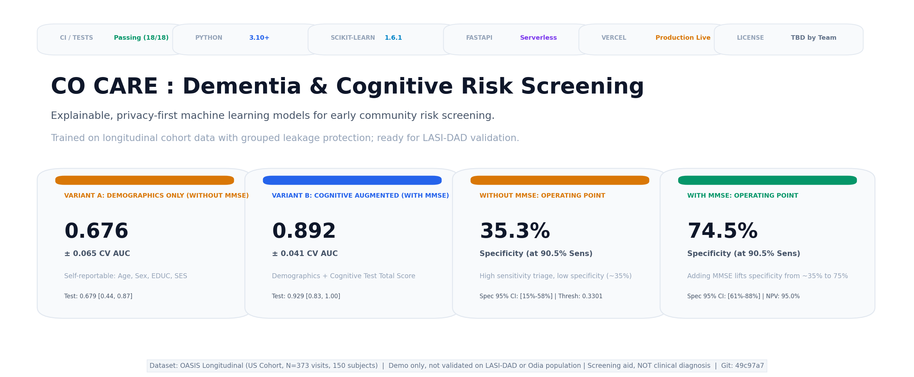

# CO CARE

AI-assisted, culturally adapted cognitive games for elderly users.  
Primary language: **Odia** · Fallback: **English**

This is the Minor-phase build: an elderly-friendly web app with 3 games, Odia-localized and generic content, session logging, and a transparent rule-based adaptive difficulty engine.

Repository: [https://github.com/AnkitaPriyadarshini-repos/cocare-neurorisk](https://github.com/AnkitaPriyadarshini-repos/cocare-neurorisk)

---

## Run It (Windows)

**Only Python is needed to run the app.** The frontend is already built into `frontend/dist`.

1. Double-click `start.bat`. The first run installs the Python packages.
2. Open http://localhost:8000 in a browser.
3. To try it on a phone, connect the phone to the same Wi-Fi and open `http://<your-PC-IP>:8000`.

You can also run it by hand:

```bash
cd backend
pip install -r requirements.txt
python -m uvicorn app.main:app --host 0.0.0.0 --port 8000
```

API docs: http://localhost:8000/docs

---

## Editing the Frontend (needs Node.js 20+)

```bash
cd frontend
npm install
npm run dev        # live-reload dev server on http://localhost:5173 (keep the backend running too)
npm run build      # rebuild frontend/dist so the backend serves your changes
```

---

## Run the Tests

```bash
# Backend & ML tests
cd backend
pip install pytest httpx
python -m pytest -q

# From repo root: run backend, ML pipeline, and showcase tests
pytest backend/tests/ ml/tests/
```

---

## Project Structure

```
backend/
  app/main.py        API routes (users, sessions, attempts, history, CSV export)
  app/adaptive.py    Adaptive difficulty rules + level settings per game   <- core research logic
  app/db.py          SQLite schema (users, user_levels, sessions, attempts, adaptation_log)
  app/content.py     Loads game content
  app/risk.py        Stateless risk screening inference & model loading
  app/explain.py     Lightweight runtime feature occlusion explanation
  models/            Exported production models & JSON metadata
  content/items_localized.json   Odia cultural items (study condition A)
  content/items_generic.json     Generic items        (study condition B)
  tests/             API, adaptive logic, and risk endpoint tests
frontend/
  src/App.jsx        Screen flow and API calls
  src/games/         MemoryMatch, PictureRecall, FindIt
  src/screens/       Welcome (consent), Home, Result, History, Settings
  src/components/    Risk check wizard and progress visualization
  src/i18n.js        Odia + English UI text (English is used when an Odia string is missing)
  src/speech.js      Read-aloud (browser voice for now; Indic-TTS audio in step 8)
ml/
  src/               Ingestion, training, evaluation, calibration, and visualization
  config/            YAML schemas for OASIS and LASI-DAD feature mapping
  reports/           Reproducible JSON metrics, operating points, and audit logs
docs/
  RISK_SCREENING.md  Full 19-figure ML showcase, validation methodology, and odds ratios
  DEPLOY.md          Deployment guide (local vs Vercel live demo, smoke tests)
  showcase/          Generated visual assets, data sidecars, and figure manifest
```

---

## The Three Games

| Game | Skill | What gets harder with level (1 to 5) |
|:---|:---|:---|
| **Match the Pairs** (ଯୋଡ଼ି ମିଳାନ୍ତୁ) | Memory | 3 to 8 pairs; preview 5 s to 2 s |
| **Remember the Pictures** (ଛବି ମନେ ରଖନ୍ତୁ) | Recall | 2 to 6 pictures to remember among 4 to 12 options |
| **Find It** (ଖୋଜି ବାହାର କରନ୍ତୁ) | Attention | Grid of 4 to 16; time limit 15 s to 8 s |

---

## Adaptive Rules (`backend/app/adaptive.py`)

The rules are checked at the end of every game. The first rule that matches decides the result:

| Rule | Condition | Effect |
|:---|:---|:---:|
| `R0_FIXED_MODE` | User is in the fixed-difficulty condition | No change |
| `R1_ABANDONED` | Game stopped before finishing | Level −1 |
| `R2_LOW_ACCURACY` | Accuracy < down threshold (40% memory, 50% others) | Level −1 |
| `R3_STRUGGLING` | Accuracy < 70% **and** median response > 1.5 × target time | Level −1 |
| `R4_HIGH_PERFORMANCE` | Accuracy ≥ up threshold (70% memory, 85% others) **and** median response ≤ target time | Level +1 |
| `R5_KEEP` | Anything else | No change |

Every decision is saved in `adaptation_log` with the rule name, the reason, and the numbers behind it.

---

## Study Conditions

Set them per player in **Caregiver / researcher settings** on the home screen:
- **Content**: Odia (localized) or Generic. Tests research question 1.
- **Difficulty**: Adaptive or Fixed. Tests research question 2.

The same screen has CSV downloads of all tables for analysis.

---

## Before the User Study (TODO)

- [ ] A native Odia speaker checks all Odia text (`src/i18n.js` and `content/*.json`).
- [ ] Replace approximate emoji with real photos for items marked `"needs_photo": true` (e.g. pakhala, rasagola, chhena poda, Sambalpuri saree). Put images in `frontend/public/images/` and set `"image": "/images/<file>.jpg"`.
- [ ] Step 8: generate Odia audio with Indic-TTS and play it from `speech.js`.
- [ ] Ethics approval and printed consent form.

---

## Cognitive Risk Screening (ML) — Overview

<picture>
  <source media="(prefers-color-scheme: dark)" srcset="docs/showcase/figures/01_hero_banner-dark.png">
  <source media="(prefers-color-scheme: light)" srcset="docs/showcase/figures/01_hero_banner-light.png">
  
</picture>

CO CARE includes two lightweight, stateless screening models designed for community intake:
1. **`model_without_mmse`**: Demographics-only intake model (`Age`, `Sex`, `EDUC`, `SES`) for settings where clinical testing is unavailable.
2. **`model_with_mmse`**: Cognitive-augmented model augmenting demographics with total cognitive score (`Age`, `Sex`, `EDUC`, `SES`, `MMSE`/`HMSE`).

### Key Validation Performance (OASIS Longitudinal Cohort)

| Model Variant | Primary CV ROC-AUC | Held-Out Test ROC-AUC [95% CI] | Sensitivity | Specificity | Inference Latency |
|:---|:---:|:---:|:---:|:---:|:---:|
| **`model_with_mmse`** | **0.892 ± 0.041** | **0.929** [0.847, 0.986] | **90.5%** [75.0%, 100.0%] | **74.5%** [62.3%, 86.5%] | ~1 ms (local, warm) |
| **`model_without_mmse`** | **0.654 ± 0.062** | **0.679** [0.538, 0.811] | **90.5%** [75.0%, 100.0%] | **35.3%** [22.7%, 47.9%] | ~1 ms (local, warm) |

> ⚠️ **DEMO models trained on OASIS (a US cohort). They have NOT been validated on LASI-DAD or on Odia-speaking/Indian populations and must not be used for screening real participants.**
>
> **Clinical Disclaimer**: This screening tool is strictly a preliminary risk screening demonstration for community and primary care workflows. It is **NOT a clinical diagnosis** and must never replace comprehensive neuropsychological or neurological evaluation by a qualified medical professional.

👉 **For the complete 19-figure showcase, training dynamics, odds ratios, longitudinal trajectories, and Bayes prevalence analysis, see [docs/RISK_SCREENING.md](docs/RISK_SCREENING.md).**

---

## Deployment Summary

CO CARE can run locally (recommended for collecting study data) or on Vercel as a live demo:

| Feature / Aspect | Local (`start.bat`) | Vercel Live Demo |
|:---|:---|:---|
| **Game session logging** | Persistent SQLite file (`backend/cocare.db`) | In-memory/ephemeral (`/tmp/cocare.db`, resets on cold starts) |
| **Intended use** | Research study data collection | Live public demo and technical review |
| **Risk-screening screens** | Controlled by `VITE_ENABLE_RISK_CHECK` | Controlled by `VITE_ENABLE_RISK_CHECK` |
| **Live URL** | `http://localhost:8000` | [https://cocare-zeta.vercel.app](https://cocare-zeta.vercel.app) |

👉 **For step-by-step Vercel setup, dual-deployment configuration, serverless size limits, and smoke tests, see [docs/DEPLOY.md](docs/DEPLOY.md).**

---

## Related Work and Acknowledgements

This showcase references concepts and problem formulations from related open-source research projects:
- **[JacobW4/cnn-dementia-classification](https://github.com/JacobW4/cnn-dementia-classification)**: A deep learning binary CNN classifying brain MRI images (Healthy vs. Very Mild Dementia) using TensorFlow/Keras, which demonstrated the value of presenting clear optimization convergence trajectories (loss and accuracy curves) and class-wise precision/recall evaluation.
- **[Albert-L-Phan/Dementia](https://github.com/Albert-L-Phan/Dementia)**: A spatial regression study of self-reported dementia incidence across Australian Local Government Areas (LGAs), which highlighted the importance of analyzing demographic, socioeconomic, and environmental risk factors.

### Licenses and Code Independence
- **No code, weights, or visual assets were copied** from either repository. CO CARE's models, pipeline, APIs, and figures were engineered independently from scratch for tabular and cognitive screening.
- **License Status of Referenced Repositories**:
  - **[JacobW4/cnn-dementia-classification](https://github.com/JacobW4/cnn-dementia-classification)**: No standalone LICENSE file found in repository (`no license found`). README states under License: *"This project is for educational purposes. Dataset is subject to Kaggle's terms of use."*
  - **[Albert-L-Phan/Dementia](https://github.com/Albert-L-Phan/Dementia)**: No license file found in repository (`no license found`).
- **CO CARE License**: License to be decided by the project team.
