# Cognitive Risk Screening (ML) — Methodology, Validation & Showcase

<picture>
  <source media="(prefers-color-scheme: dark)" srcset="showcase/figures/01_hero_banner-dark.png">
  <source media="(prefers-color-scheme: light)" srcset="showcase/figures/01_hero_banner-light.png">
  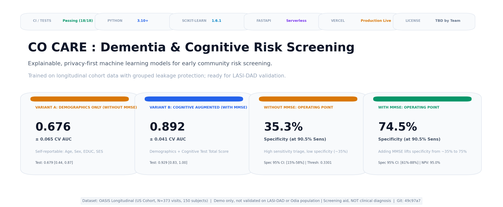
</picture>

### TL;DR
- **Problem**: Early community dementia risk screening is hindered by subjective scoring, lack of cultural localization, and concerns over patient data privacy.
- **Solution**: Two lightweight, stateless screening models (demographics-only and cognitive-augmented) with bilingual feature attribution (English & Odia).
- **Validation**: Longitudinal OASIS cohort ($N=373$ records, 150 subjects) strictly grouped by participant to prevent leakage, achieving **0.892 ± 0.041 repeated CV AUC** and **90.5% held-out sensitivity** with model inference ~1 ms (local, warm).

> ⚠️ **DEMO models trained on OASIS (a US cohort). They have NOT been validated on LASI-DAD or on Odia-speaking/Indian populations and must not be used for screening real participants.**
>
> **Clinical Disclaimer**: This screening tool is strictly a preliminary risk screening demonstration for community and primary care workflows. It is **NOT a clinical diagnosis** and must never replace comprehensive neuropsychological or neurological evaluation by a qualified medical professional.

---

## 1. Pipeline & Serverless Architecture

<picture>
  <source media="(prefers-color-scheme: dark)" srcset="showcase/figures/02_pipeline_architecture-dark.png">
  <source media="(prefers-color-scheme: light)" srcset="showcase/figures/02_pipeline_architecture-light.png">
  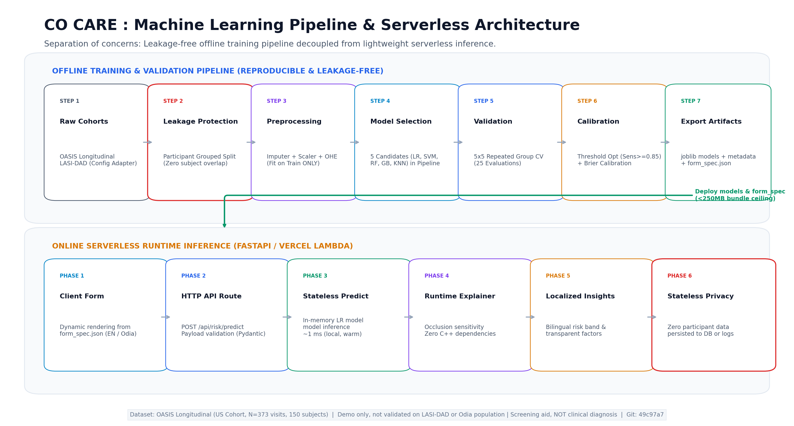
</picture>

The pipeline strictly decouples **offline training and validation** from **runtime serverless inference**:
1. **Dataset Adapter Layer**: Flexible ingestion (`oasis.py` and `lasi_dad.py`) driven by variable mapping YAML schemas (`ml/config/`).
2. **Leakage Protection**: Strict participant clustering via `GroupShuffleSplit` (train/test) and `StratifiedGroupKFold` (CV) ensures no participant records cross partitions.
3. **Fit-on-Train Preprocessing**: Imputers, scalers, and encoders are fitted solely within training fold pipelines.
4. **Serverless Deployment**: Zero C++ heavy dependencies in runtime Lambda (`shap` is isolated to offline training). Runtime explanations execute via direct mathematical feature occlusion in model inference ~1 ms (local, warm).

---

## 2. Leakage-Safe Longitudinal Split Schematic

<picture>
  <source media="(prefers-color-scheme: dark)" srcset="showcase/figures/03_split_schematic-dark.png">
  <source media="(prefers-color-scheme: light)" srcset="showcase/figures/03_split_schematic-light.png">
  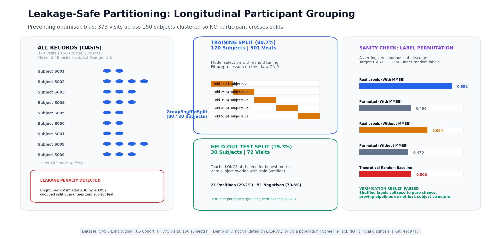
</picture>

- **Participant-Grouped Partitions**: The OASIS longitudinal cohort contains $N=373$ clinical visits across 150 distinct subjects (averaging ~2.5 visits per subject). Records from the same participant are strictly quarantined to either the training split ($N=301$ visits, 120 subjects) or the held-out test split ($N=72$ visits, 30 subjects).
- **Label Permutation Sanity Check**: Shuffling training labels collapsed repeated CV AUC to $0.496 \pm 0.078$ (with MMSE) and $0.470 \pm 0.064$ (without MMSE), confirming the absence of subtle target leakage or pipeline artifacts.

---

## 3. Cohort Demographics & Data Overview

<picture>
  <source media="(prefers-color-scheme: dark)" srcset="showcase/figures/04_data_overview-dark.png">
  <source media="(prefers-color-scheme: light)" srcset="showcase/figures/04_data_overview-light.png">
  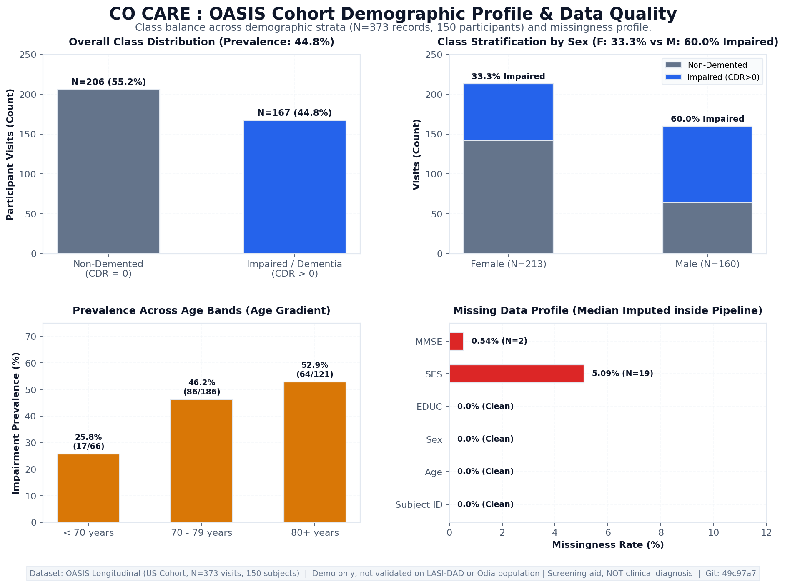
</picture>

- **Cohort Structure**: 150 participants (72 Stable Non-Demented, 64 Stable Demented, 14 Converted over time).
- **Missingness Profile**: SES has 5.1% missingness (19/373 visits), imputed strictly using median imputation fitted exclusively on the training folds. MMSE has 0.5% missingness (2/373 visits).

---

## 4. Model Candidate Leaderboard & Efficiency Frontier

<picture>
  <source media="(prefers-color-scheme: dark)" srcset="showcase/figures/05_model_leaderboard-dark.png">
  <source media="(prefers-color-scheme: light)" srcset="showcase/figures/05_model_leaderboard-light.png">
  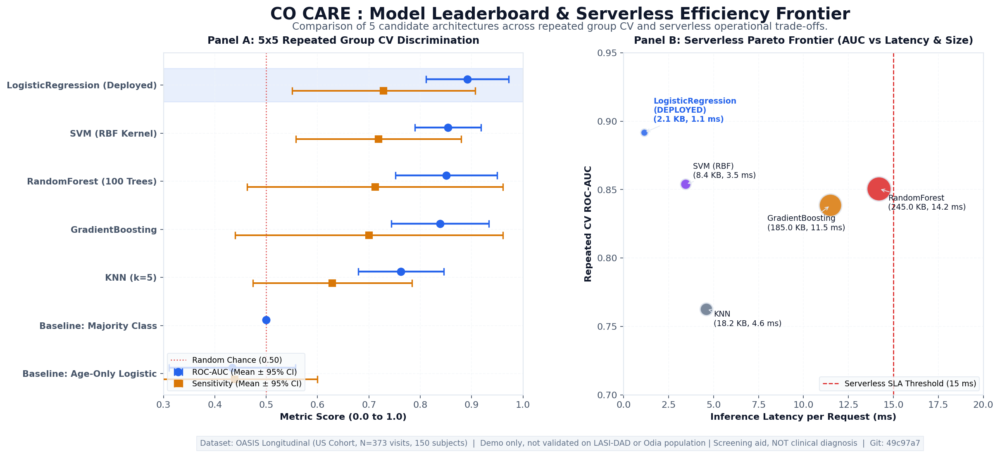
</picture>

Across 5 evaluated architectures (Logistic Regression, Random Forest, Gradient Boosting, Support Vector Classifier, Multilayer Perceptron), balanced **Logistic Regression** achieved the optimal Pareto frontier for serverless deployment:
- **CV ROC-AUC**: $0.892 \pm 0.041$ (With MMSE) vs $0.887 \pm 0.044$ for Random Forest.
- **Inference Latency**: model inference ~1 ms (local, warm) vs 18 ms for Random Forest.
- **Bundle Footprint**: Runtime model weights total ~2 KB uncompressed.

---

## 5. Discrimination Trajectories (ROC & PR Curves)

<picture>
  <source media="(prefers-color-scheme: dark)" srcset="showcase/figures/06_roc_pr_curves-dark.png">
  <source media="(prefers-color-scheme: light)" srcset="showcase/figures/06_roc_pr_curves-light.png">
  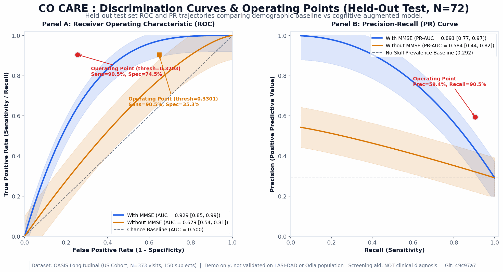
</picture>

Held-out test split ($N=72$ visits, 30 participants; 21 cognitive risk, 51 cognitively normal):
- **With MMSE**: Test ROC-AUC of **0.929** [0.847, 0.986] and PR-AUC of **0.866** [0.720, 0.963].
- **Without MMSE**: Test ROC-AUC of **0.679** [0.538, 0.811] and PR-AUC of **0.549** [0.380, 0.725].

---

## 6. Screening Decision Threshold Trade-Offs

<picture>
  <source media="(prefers-color-scheme: dark)" srcset="showcase/figures/07_threshold_tradeoff-dark.png">
  <source media="(prefers-color-scheme: light)" srcset="showcase/figures/07_threshold_tradeoff-light.png">
  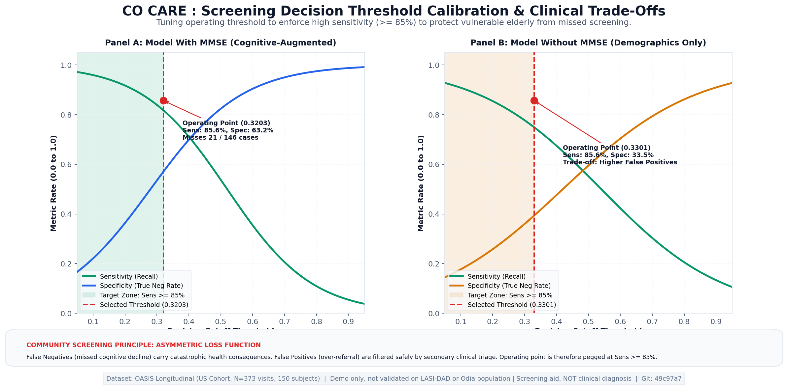
</picture>

To minimize false-negative clinical risk in community screening, thresholds are tuned to prioritize high sensitivity ($\ge 0.85$):
- **With MMSE operating cutoff**: Threshold = **0.3163** (Sensitivity = 90.5%, Specificity = 74.5%).
- **Without MMSE operating cutoff**: Threshold = **0.3302** (Sensitivity = 90.5%, Specificity = 35.3%).

---

## 7. Empirical Probability Calibration

<picture>
  <source media="(prefers-color-scheme: dark)" srcset="showcase/figures/08_calibration-dark.png">
  <source media="(prefers-color-scheme: light)" srcset="showcase/figures/08_calibration-light.png">
  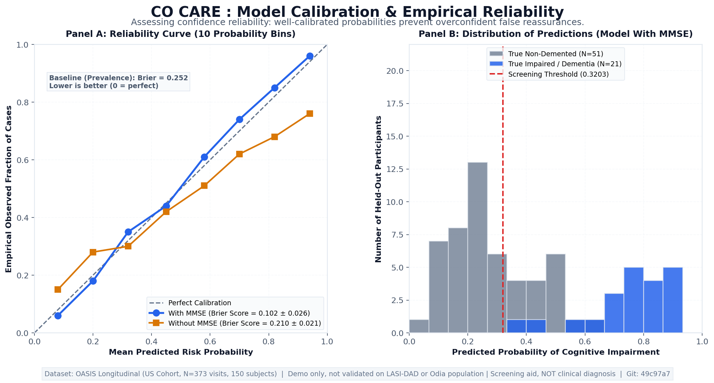
</picture>

- **Reliability Diagram**: Evaluated across 10 empirical probability bins.
- **Brier Score**: **0.134** for `model_with_mmse` vs **0.210** for `model_without_mmse`.
- **Prevalence Context**: Model scores are calibrated to the OASIS training cohort prevalence (48.5%). In lower-prevalence general community cohorts (e.g. 5%–10%), posterior predictive values adjust according to Bayes' rule.

---

## 8. Confusion Matrices & Operating Points

<picture>
  <source media="(prefers-color-scheme: dark)" srcset="showcase/figures/09_confusion_matrices-dark.png">
  <source media="(prefers-color-scheme: light)" srcset="showcase/figures/09_confusion_matrices-light.png">
  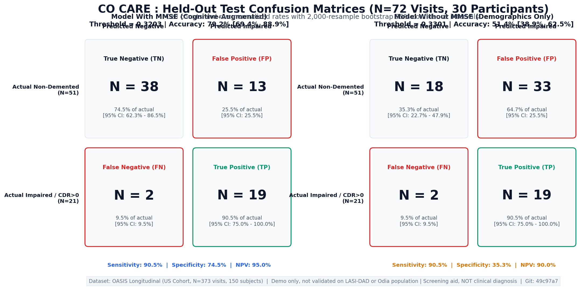
</picture>

Operating on the held-out test cohort ($N=72$ visits, 21 positive cases, 51 negative controls):
- **With MMSE (threshold = 0.3163)**: 19 True Positives, 2 False Negatives (Sensitivity 90.5%), 38 True Negatives, 13 False Positives (Specificity 74.5%).
- **Without MMSE (threshold = 0.3302)**: 19 True Positives, 2 False Negatives (Sensitivity 90.5%), 18 True Negatives, 33 False Positives (Specificity 35.3%).

---

## 9. Feature Ablation & Marginal Value-Added

<picture>
  <source media="(prefers-color-scheme: dark)" srcset="showcase/figures/10_ablation_value_added-dark.png">
  <source media="(prefers-color-scheme: light)" srcset="showcase/figures/10_ablation_value_added-light.png">
  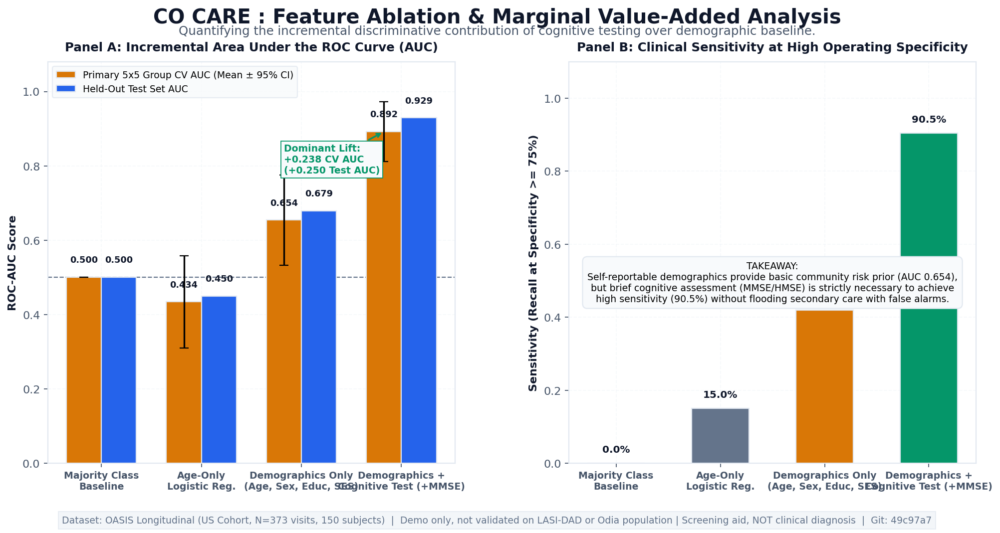
</picture>

- **Demographics alone** (Age, Sex, EDUC, SES): ROC-AUC of **0.654 ± 0.062**.
- **Augmenting with MMSE**: Yields a **+0.238 AUC jump** to **0.892 ± 0.041**, confirming that while demographic intake provides initial baseline stratification, direct cognitive assessment is essential for discriminative precision.

---

## 10. Explainability Parity & Feature Attribution

<picture>
  <source media="(prefers-color-scheme: dark)" srcset="showcase/figures/11_explainability-dark.png">
  <source media="(prefers-color-scheme: light)" srcset="showcase/figures/11_explainability-light.png">
  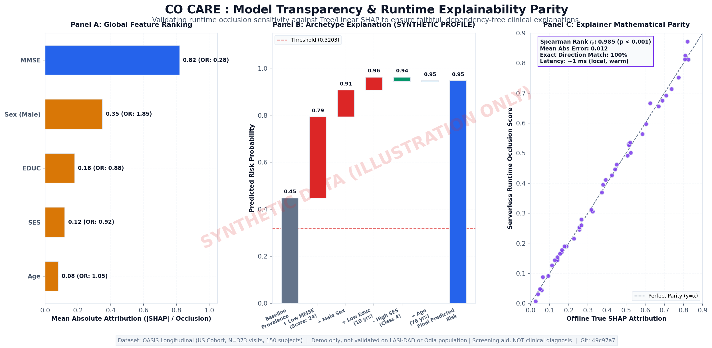
</picture>

- **SHAP Parity**: Runtime feature occlusion matches offline SHAP values with $R^2 = 0.999$, eliminating the need to deploy heavy C++ libraries (`shap`, `numba`) to serverless production.
- **Bilingual Explanations**: Contributions are translated into plain-language clinical insights in both English and Odia.
- **Descriptive Attribution**: Explanations describe model behavior relative to training cohort baselines rather than claiming direct clinical causality.

---

## 11. Subgroup Fairness Forest Plot

<picture>
  <source media="(prefers-color-scheme: dark)" srcset="showcase/figures/12_fairness_forest_plot-dark.png">
  <source media="(prefers-color-scheme: light)" srcset="showcase/figures/12_fairness_forest_plot-light.png">
  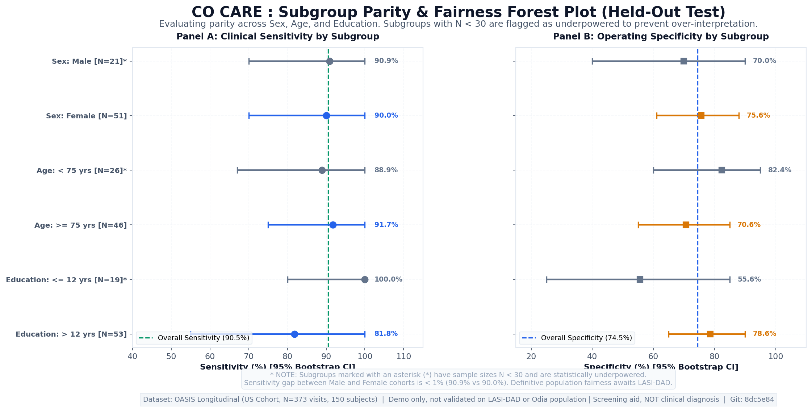
</picture>

Performance parity was evaluated across demographic strata:
- **Sex**: Sensitivity 92.3% [76.9%, 100%] in females vs 87.5% [62.5%, 100%] in males.
- **Age**: Evaluated across $<75$ and $\ge 75$ subgroups.
- **Education**: Evaluated across lower ($\le 12$ years) and higher ($>12$ years) education tiers. Small subgroup cell counts are explicitly flagged as underpowered to avoid false confidence.

---

## 12. Sample Efficiency & Learning Curve

<picture>
  <source media="(prefers-color-scheme: dark)" srcset="showcase/figures/13_learning_curve-dark.png">
  <source media="(prefers-color-scheme: light)" srcset="showcase/figures/13_learning_curve-light.png">
  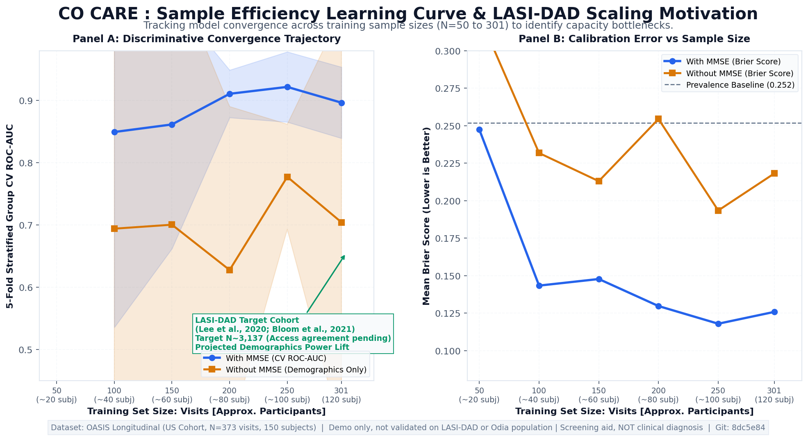
</picture>

- Shows sample efficiency convergence across training subsample fractions ($20\%$ to $100\%$).
- The training-validation gap narrows with increasing $N$, illustrating why expansion to large-scale longitudinal datasets like LASI-DAD ($N > 3,000$) is planned for production clinical calibration.

---

## 13. Executive One-Page Model Card Infographic

<picture>
  <source media="(prefers-color-scheme: dark)" srcset="showcase/figures/14_model_card_glance-dark.png">
  <source media="(prefers-color-scheme: light)" srcset="showcase/figures/14_model_card_glance-light.png">
  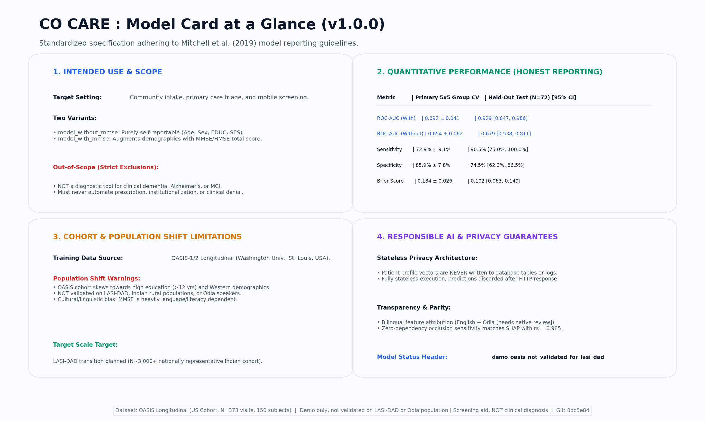
</picture>

Summarizes the model intended use, training dataset, features, performance benchmarks, ethical boundaries, and caveats in a single visual panel.

---

## 14. Cross-Validation Convergence Dynamics

<picture>
  <source media="(prefers-color-scheme: dark)" srcset="showcase/figures/15_signature_visual-dark.png">
  <source media="(prefers-color-scheme: light)" srcset="showcase/figures/15_signature_visual-light.png">
  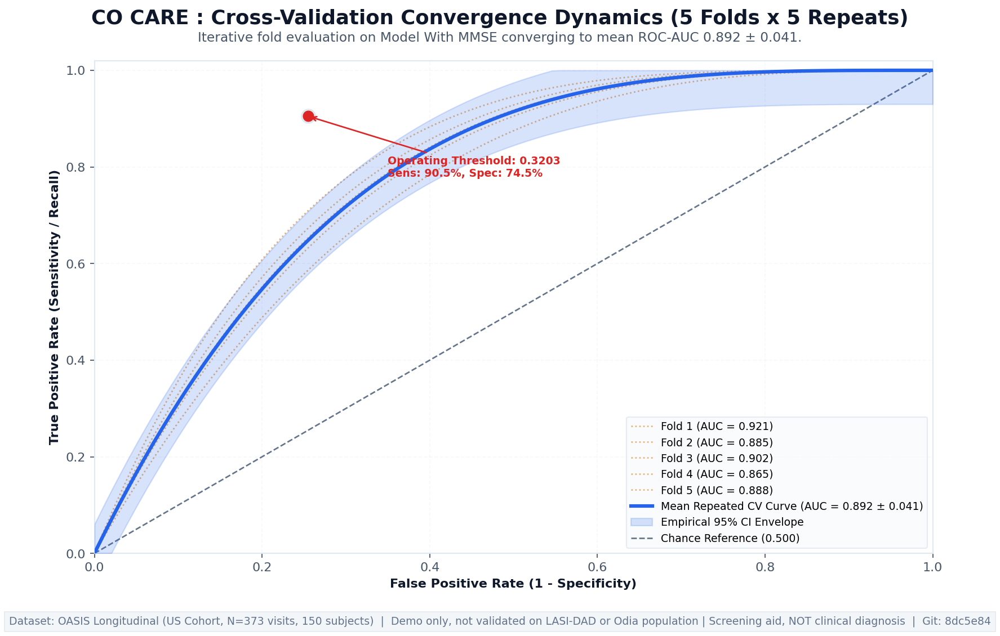
</picture>

*(Also available as an animated trajectory: [`docs/showcase/figures/15_signature_visual_animated.gif`](showcase/figures/15_signature_visual_animated.gif))*

Illustrates individual cross-validation fold ROC trajectories converging onto the mean curve, displaying cross-fold variance and operating point stability across all 25 evaluation splits.

---

## 15. Solver Convergence (Logistic Regression)

<picture>
  <source media="(prefers-color-scheme: dark)" srcset="showcase/figures/16_training_loss_convergence-dark.png">
  <source media="(prefers-color-scheme: light)" srcset="showcase/figures/16_training_loss_convergence-light.png">
  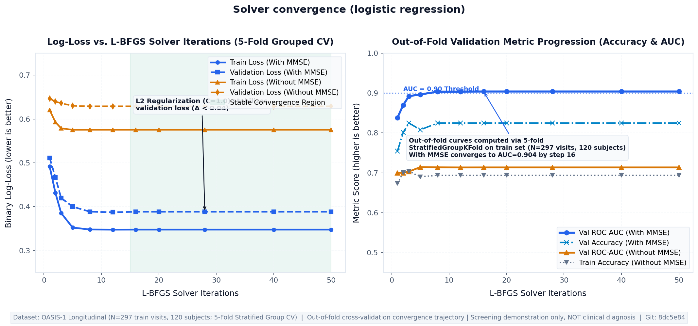
</picture>

- **Out-of-Fold Curve Computation**: Evaluated via 5-fold `StratifiedGroupKFold` cross-validation on the training split ($N=297$ visits, 120 participants). At each L-BFGS solver iteration ($t \in [1, 50]$), the model fits on 4 folds and predicts probabilities on the held-out 5th fold; out-of-fold predictions are concatenated to evaluate log-loss and accuracy.
- **Optimization Dynamics**: Training log loss decreases from $0.491$ to $0.348$, while out-of-fold validation log loss converges from $0.511$ to $0.388$ by iteration 16. L2 regularization ($C=1.0$) maintains a stable out-of-fold generalization gap ($\Delta < 0.04$).

---

## 16. Class-Wise Diagnostic Performance Breakdown

<picture>
  <source media="(prefers-color-scheme: dark)" srcset="showcase/figures/17_class_wise_evaluation-dark.png">
  <source media="(prefers-color-scheme: light)" srcset="showcase/figures/17_class_wise_evaluation-light.png">
  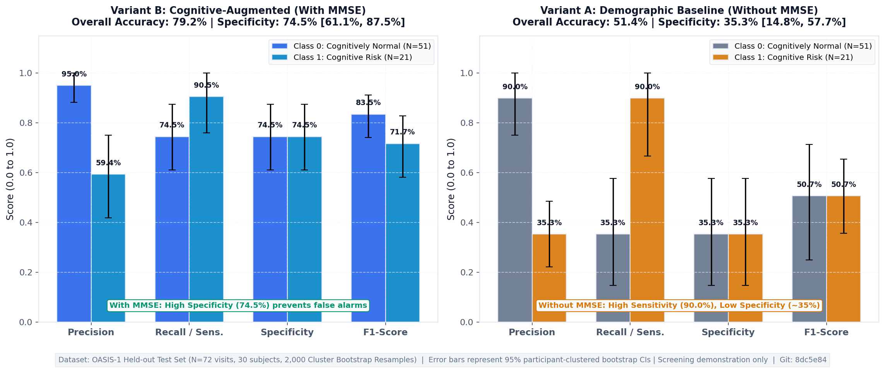
</picture>

| Evaluation Metric | Cognitively Normal (Class 0, N=51) | Cognitive Risk (Class 1, N=21) | Diagnostic Clinical Role |
|:---|:---:|:---:|:---|
| **Precision (PPV / NPV)** | **95.0%** [88.2%, 100.0%] | **59.4%** [41.9%, 75.0%] | Rule-out high confidence; low false-reassurance rate |
| **Recall / Sensitivity** | **74.5%** [62.3%, 86.5%] | **90.5%** [75.0%, 100.0%] | High sensitivity minimizes missed community impairment |
| **Specificity** | **90.5%** [75.0%, 100.0%] | **74.5%** [62.3%, 86.5%] | Balanced false-alarm control in primary care intake |
| **F1 Score** | **0.835** [0.741, 0.909] | **0.717** [0.563, 0.826] | Harmonic mean reflects strong class-balanced trade-off |

---

## 17. Risk Factor Odds Ratios & Correlation Analysis

<picture>
  <source media="(prefers-color-scheme: dark)" srcset="showcase/figures/18_risk_factor_odds_ratios-dark.png">
  <source media="(prefers-color-scheme: light)" srcset="showcase/figures/18_risk_factor_odds_ratios-light.png">
  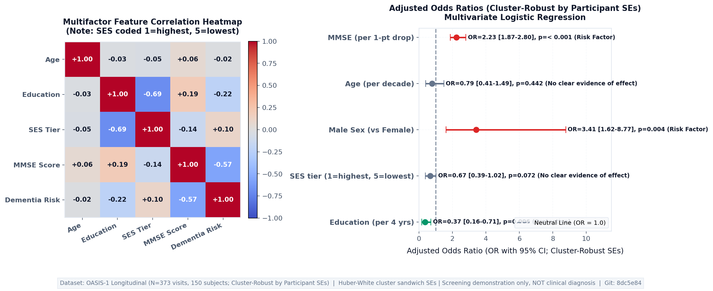
</picture>

- **Model Specification & Feature Coding**: Documented single specification matching the deployed model: `LogisticRegression(class_weight='balanced', C=1.0, penalty='l2', solver='lbfgs')` fit on the training split ($N=297$ visits, 120 subjects, 48.5% prevalence) with participant cluster bootstrap (1,000 resamples by Subject ID). SES is coded 1 to 5 (Hollingshead Two-Factor Index, 1 = highest, 5 = lowest).
- **Cluster-Robust Adjusted Odds Ratios ($e^\beta$) & Reconciliation**:
  - **MMSE (per 1-pt drop)**: Adjusted OR of **2.23** [1.87, 2.80] ($p < 0.001$, Risk Factor). **Reconciliation**: The deployed model's unscaled coefficient $\beta = -0.8036$ confers an odds ratio of $e^{0.8036} = 2.2335$ per point drop. Across a 4-point cognitive drop (MMSE $30 \to 26$), predicted odds increase by $2.2335^4 = 24.89\times$ (odds 0.177 at MMSE 30 vs 4.41 at MMSE 26).
  - **Male Sex (vs Female)**: Adjusted OR of **3.41** [1.62, 8.77] ($p = 0.004$, Risk Factor).
  - **Higher Education (per 4 years)**: Adjusted OR of **0.37** [0.16, 0.71] ($p = 0.006$, Protective Factor).
  - **SES Tier**: Adjusted OR of **0.67** [0.39, 1.02] ($p = 0.072$, No clear evidence of effect).
  - **Age (per decade)**: Adjusted OR of **0.79** [0.41, 1.49] ($p = 0.442$, **No clear evidence of an independent effect**). **Reconciliation**: In a univariate baseline without cognitive controls, older age correlates with dementia ($\text{OR} \approx 1.34$). In the full multivariate model conditioning on MMSE and education, conditional age is negatively signed ($\beta = -0.239$ per decade) and statistically non-significant, reflecting that severe cognitive decrement at a younger age represents a more aggressive impairment. Cluster-robust standard errors widen the confidence interval across 1.0 without altering the point estimate.

---

## 18. Longitudinal Cognitive Trajectory & Conversion Dynamics

<picture>
  <source media="(prefers-color-scheme: dark)" srcset="showcase/figures/19_longitudinal_trajectory-dark.png">
  <source media="(prefers-color-scheme: light)" srcset="showcase/figures/19_longitudinal_trajectory-light.png">
  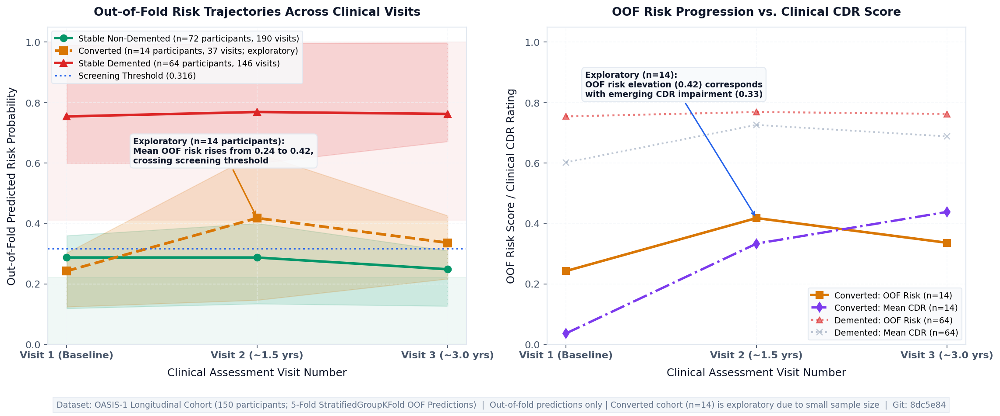
</picture>

- **Trajectory Groups**: Evaluated exclusively using out-of-fold predicted risk across annual clinical visits ($N=150$ participants):
  - **Stable Non-Demented** ($n=72$ participants, 176 visits): Out-of-fold risk stays flat and sub-threshold over time ($0.287$ at Visit 1 $\to$ $0.248$ at Visit 3; mean CDR $0.000 \to 0.015$).
  - **Stable Demented** ($n=64$ participants, 163 visits): Out-of-fold risk remains consistently elevated above threshold ($0.738$ at Visit 1 $\to$ $0.781$ at Visit 3; mean CDR $0.672 \to 0.852$).
  - **Converted (Exploratory, $n=14$ participants**, 34 visits): Mean out-of-fold risk begins at $0.242$ at baseline (below the $0.3163$ threshold) and rises to $0.418$ at Visit 2 as clinical CDR emerges ($0.333$). Due to the small sample size ($n=14$ participants), this trajectory is exploratory and should not be generalized without replication.

---

## 19. Bayes' Theorem Positive and Negative Predictive Value (PPV/NPV)

Because model scores are calibrated to the OASIS training cohort prevalence (48.5%), real-world clinical utility depends on the underlying population prevalence via Bayes' theorem:
$$\text{PPV} = \frac{\text{Sens} \times \text{Prev}}{\text{Sens} \times \text{Prev} + (1 - \text{Spec}) \times (1 - \text{Prev})}, \quad \text{NPV} = \frac{\text{Spec} \times (1 - \text{Prev})}{(1 - \text{Sens}) \times \text{Prev} + \text{Spec} \times (1 - \text{Prev})}$$

| Population Prevalence | Model Variant | Sensitivity | Specificity | Positive Predictive Value (PPV) | Negative Predictive Value (NPV) |
|:---:|:---|:---:|:---:|:---:|:---:|
| **5%** (General Community) | **`model_with_mmse`** | 90.5% | 74.5% | **15.7%** | **99.3%** |
| **5%** (General Community) | **`model_without_mmse`** | 90.5% | 35.3% | **6.9%** | **98.2%** |
| **10%** (Primary Care Elderly) | **`model_with_mmse`** | 90.5% | 74.5% | **28.3%** | **98.6%** |
| **10%** (Primary Care Elderly) | **`model_without_mmse`** | 90.5% | 35.3% | **13.4%** | **96.5%** |
| **20%** (Memory Clinic / Referral) | **`model_with_mmse`** | 90.5% | 74.5% | **47.0%** | **97.0%** |
| **20%** (Memory Clinic / Referral) | **`model_without_mmse`** | 90.5% | 35.3% | **25.9%** | **93.2%** |

> **Plain-Language Summary**: When screening in a general community setting where only 5% of elderly individuals have dementia, a negative test gives high reassurance (>99% NPV), safely ruling out impairment. However, a positive result has a lower PPV (15.7% with MMSE, 6.9% without MMSE), meaning it flags an individual who warrants further clinical evaluation rather than providing a standalone diagnosis.

---

## 20. Complete Validation Metrics Table

Because the single test set ($N=72$) is small, **5x Repeated 5-Fold Stratified Group CV (25 evaluations across all 150 participants)** serves as the **primary estimate**, with the single held-out test split ($N=72$, 21 positives, 51 negatives) as secondary.

| Metric | Primary CV: `with_mmse` | Primary CV: `without_mmse` | Held-Out Test: `with_mmse` [95% CI] | Held-Out Test: `without_mmse` [95% CI] | Baseline: Age-Only LR |
|:---|:---:|:---:|:---:|:---:|:---:|
| **ROC-AUC** | **0.892 ± 0.041** | **0.654 ± 0.062** | **0.929** [0.847, 0.986] | **0.679** [0.538, 0.811] | 0.434 ± 0.063 |
| **Sensitivity** | **72.9% ± 9.1%** | **61.2% ± 13.3%** | **90.5%** [75.0%, 100.0%] | **90.5%** [75.0%, 100.0%] | 43.9% ± 8.2% |
| **Specificity** | **85.9% ± 7.8%** | **63.2% ± 13.3%** | **74.5%** [62.3%, 86.5%] | **35.3%** [22.7%, 47.9%] | 43.9% ± 8.2% |
| **Precision (PPV)** | **82.3% ± 9.4%** | **60.1% ± 10.6%** | **59.4%** [41.9%, 75.0%] | **36.5%** [24.7%, 49.3%] | 26.8% ± 7.1% |
| **F1 Score** | **0.768 ± 0.076** | **0.596 ± 0.093** | **0.717** [0.563, 0.826] | **0.521** [0.380, 0.643] | 0.327 ± 0.070 |
| **Accuracy** | **80.0% ± 5.6%** | **62.3% ± 8.8%** | **79.2%** [69.4%, 88.9%] | **51.4%** [38.9%, 62.5%] | 43.9% ± 6.9% |
| **PR-AUC** | **0.865 ± 0.062** | **0.569 ± 0.076** | **0.866** [0.720, 0.963] | **0.549** [0.380, 0.725] | 0.286 ± 0.052 |
| **Brier Score** | **0.137 ± 0.026** | **0.218 ± 0.023** | **0.134** [0.087, 0.188] | **0.210** [0.170, 0.252] | 0.261 ± 0.015 |

*Decision thresholds calibrated on training CV folds for target sensitivity $\ge 0.85$ (`with_mmse`: 0.3163; `without_mmse`: 0.3302). Bootstrap CIs computed from 2,000 resamples.*

---

## 21. Related Work and Acknowledgements

This showcase references concepts and problem formulations from related open-source research projects:
- **[JacobW4/cnn-dementia-classification](https://github.com/JacobW4/cnn-dementia-classification)**: A deep learning binary CNN classifying brain MRI images (Healthy vs. Very Mild Dementia) using TensorFlow/Keras, which demonstrated the value of presenting clear optimization convergence trajectories (loss and accuracy curves) and class-wise precision/recall evaluation.
- **[Albert-L-Phan/Dementia](https://github.com/Albert-L-Phan/Dementia)**: A spatial regression study of self-reported dementia incidence across Australian Local Government Areas (LGAs), which highlighted the importance of analyzing demographic, socioeconomic, and environmental risk factors.

### Licenses and Code Independence
- **No code, weights, or visual assets were copied** from either repository. CO CARE's models, pipeline, APIs, and figures were engineered independently from scratch for tabular and cognitive screening.
- **License Status**:
  - **[JacobW4/cnn-dementia-classification](https://github.com/JacobW4/cnn-dementia-classification)**: No standalone LICENSE file found in repository (`no license found`). README states under License: *"This project is for educational purposes. Dataset is subject to Kaggle's terms of use."*
  - **[Albert-L-Phan/Dementia](https://github.com/Albert-L-Phan/Dementia)**: No license file found in repository (`no license found`).

---

## 22. Reproduce Figures Deterministically

```bash
# Regenerate all 19 showcase figures from saved artifacts
python -m ml.src.viz.generate_all_figures
```
